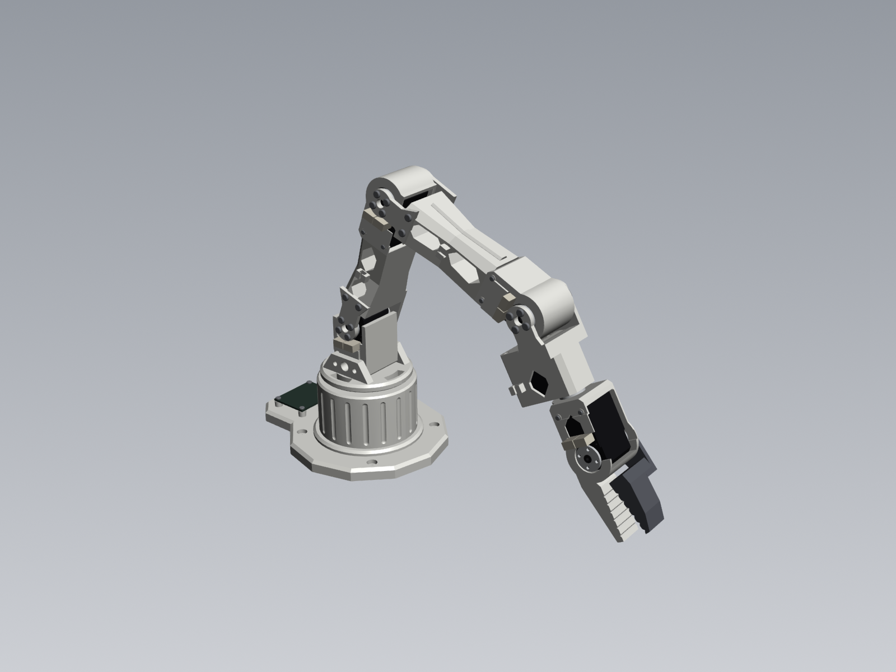

# Talos

A 3D-printed desktop robot arm: five axes plus a gripper, about 420 mm of reach, driven by six Feetech STS3215 bus servos. It's a two-person project. Lucas does the mechanical design (CAD, calcs, printing), and Ryan does the simulation and software. The arm takes its size and servo from the open-source SO-101 arm, but every part is its own design.

## What's on this branch

| Path | What it is |
| --- | --- |
| `cad/step/talos_arm_assembly.step` | The whole arm, every part and servo, in its ready pose. The STEP is Y-up, the SolidWorks convention |
| `cad/step/TAL-1xx_*.step` | One STEP per printed part, in the part's own frame (the frame its drawing uses) |
| `cad/print/TAL-1xx_*.3mf` | Print-ready files: each part already turned onto its print face, in millimetres |
| `calcs/` | Torque, stress, payload and dynamics checks, with results: see [`calcs/README.md`](calcs/README.md) |
| `robotic arm planmd.md` | The project plan |

The parts are split into two drawing sets. This branch has **set A**: the base, shoulder, upper arm, hub caps, servo fit gauge and pocket test piece. Set B and the rest live on other branches:

| Branch | What's there |
| --- | --- |
| `cad` | Set B parts (forearm, wrist, gripper body, moving jaw, idler plates, clevis test piece), the CadQuery source (`cad/talos_arm.py`), the full 23-sheet drawing set, and every check script |
| `sim/mujoco` | The MuJoCo simulation |

The calcs scripts import `cad/talos_arm.py`, so to rerun them, check out `cad`.

| Part | Name | Qty | On the bed |
| --- | --- | --- | --- |
| TAL-101 | Base | 1 | Plinth down |
| TAL-102 | Shoulder (turntable and cradle) | 1 | Turntable down |
| TAL-103 | Upper arm | 1 | Flat underside down |
| TAL-108 | Hub cap | 3 | Outer face down |
| TAL-111 | Servo fit gauge | 1 | Flat. Print it first |
| TAL-112 | Pocket test piece | 1 | Flat underside down, like TAL-103 |

## The arm in numbers

| | |
| --- | --- |
| Servos | 6 × Feetech STS3215, 12 V, 30 kg·cm (2.94 N·m stall), on one serial bus |
| Joints | Pan, shoulder, elbow, wrist flex, wrist roll, gripper |
| Links | Shoulder to elbow 116 mm, elbow to wrist 135 mm, wrist to roll flange 63 mm, roll flange to jaw tip 108 mm |
| Reach | About 420 mm from the shoulder axis |
| Joint ranges | Shoulder ±100°, elbow ±100°, wrist flex −100° to +95°, pan ±110° and wrist roll ±150° (set by the cables) |
| Moving mass | 522 g (70 % of it servos), 738 g with the base |
| Material | PLA, 0.2 mm layers, 3 walls, 20 % infill |

## Design decisions

**SO-101 as the reference, not the template.** SO-101 is a proven arm built on the same servo, so Talos copies its proportions, its servo, and how it holds a servo: the servo slides into the printed part and screws in from outside. The parts themselves are drawn from scratch. There's a 12-sided plinth with a fluted column, and the links are faceted octagonal beams that narrow at the waist, with hex windows.

**CAD as code.** The whole arm is one parametric CadQuery script. Every size comes from named constants, so a change, like a new printing clearance, moves every part at once. The print files, STEPs and drawings are all generated from it, so they can't drift apart, and checks run on the generated parts before any file is written.

**Pockets built from the real servo.** Every servo pocket is cut from Feetech's own CAD of the STS3215, taken from SO-101's assembly. A script puts that servo model into every Talos part and checks that nothing touches.

**Clearance set by a test print.** FDM holes come out a little small. So every pocket is the servo plus a clearance, set from a printed gauge rather than guessed: **0.3 mm** on the case, and 0.4 mm on the rib, bump, spline and boss. That holds for this printer setup (Ender 3 V3 KE, 0.4 mm nozzle, Creality PLA, Creality Print). On a different printer, print TAL-111 first and set the clearance from it.

**Every servo has a way in.** Each pocket has a path the servo can slide along, with channels for everything that sticks out of its case: the top rib, the bump by the connectors, the bare output shaft, the idler boss and the plugged-in cables.
- The shoulder, elbow, wrist flex and jaw servos go in with their horns off; the horns go back on through openings in the shell.
- The base and wrist roll servos go in with their horns on.
- A check script slides the real servo along each path and measures the room at every depth. Nowhere is tighter than the seated pocket.

**Clevis joints, like SO-101.** At the shoulder, elbow and wrist flex, the next link clamps both sides of the servo:
- **Output horn:** a plate screws onto it and carries the joint's torque.
- **Passive horn:** the other side, which spins freely on the back of the servo. An idler plate screws onto it and only supports.
- **Slim idler plates:** the servo's cable plugs sit only 11 mm from the joint axis on that side, so the idler plates are pinched to clear them through the whole joint range.
- **Separate idler plate:** on the arm links, it's a separate part (TAL-110), so the link prints without support.
- **Gap:** both plates turn 1.0 mm clear of the shell they straddle.

**Everything prints flat, without support.** Each part's print orientation was chosen by measuring its overhangs in all six orientations. Every part sits on one solid first layer, checked by slicing the mesh 0.2 mm above the bed. Two print effects are designed in:
- **Elephant's foot:** where a servo goes in through the face a part prints on (the arm links), there's a 0.5 mm × 45° lead-in.
- **Bridge sag:** pocket walls that print as long bridges along the servo's whole way in get 0.2 mm more room.

**Screws.**
- Horn screws are M3 × 6 everywhere, with 1.65 to 2.5 mm of thread in the horn, ending short of the servo case.
- Every servo case screw seat takes either an M2 × 6 or an M2 × 5: there's 2.4 mm of print under each head, so a 6 mm screw goes 3.6 mm into the case and a 5 mm one goes 2.6 mm.

**Servo mounts.**
- **Pan and wrist roll servos:** held by four case screws, two at each end, so they can't rock in their pockets.
- **Shoulder servo:** its twisting load goes into the cradle's two long walls rather than the slender posts beside its shaft.

**Wiring.** The servos are daisy-chained from a Waveshare bus adapter on a deck behind the base column. Each cable crosses its pitch joint on the joint's axis, so turning the joint barely changes its length.
- The pan → shoulder run winds round the column as the arm pans, so it needs a 35 cm cable.
- The wrist roll → jaw run winds round the roll axis, so it needs a 30 cm cable.
- The servos' own 21 cm cables do the other four runs.
- A clip on the back of the column keeps the pan cable's slack loop away from the turntable.

**Loads, and what was accepted.** With the arm straight out and 200 g in the gripper, the shoulder holds at 59 % of stall. That's over the usual 1/3-of-stall rule for continuous load (the sim agrees). For v1 this is accepted: full payload only with the elbow bent, which covers top-down picks out to 195 mm from the base. The shoulder load gets measured once the arm is built. The base tips over at full reach unless it's clamped or bolted down, so the plinth has four counterbored M4 holes.

## Problems and how they were solved

| # | Problem | Cause | Fix |
| --- | --- | --- | --- |
| 1 | The first printed parts didn't take the servos | The servo model came from SO-101's simplified simulation mesh, which is up to 1 mm small in places. The pockets also had only 0.3 mm clearance with no allowance for FDM | Rebuilt the servo from Feetech's own CAD, measured feature by feature, and gave every pocket a printing clearance |
| 2 | Most servos had no way in: the shaft and the rib on top caught on the walls | The pockets were only checked with the servo already in place | Every pocket now has a swept entry path with channels for each part that sticks out. Four servos go in with their horns off |
| 3 | The bump under the servo's wire ports was deeper than planned | Same cause as #1 | Measured from Feetech's CAD. Its channel runs the whole way in, and a 1.4 mm thickening keeps 0.9 mm of wall over it |
| 4 | The bottom case screw holes were 0.25 mm off | Taken from the simulation mesh | Hole positions measured on Feetech's CAD and checked by script against it |
| 5 | The pan servo was held by two screws at one end and could rock under the arm's overturning load | Only one hole pair was used | The servo has a second pair beside the shaft. Now four screws, worst case 38 N each |
| 6 | Two screws holding the gripper to the roll horn couldn't be fitted | The pocket floor blocked their heads | Their counterbores run on as grooves in the floor. They're fitted with the short leg of a hex key |
| 7 | How much clearance does this printer actually need? | FDM holes print small, by an amount that depends on printer, filament and slicer | A six-window test gauge (TAL-111), 0.2 to 0.7 mm. The servo was snug through 0.2 and smooth through 0.3, so the pockets went from 0.4 to 0.3 mm. A check confirms Feetech's servo passes every window in CAD, so a tight window means the printer |
| 8 | A flat gauge can't test a real pocket's full depth, bridged roof or entry through the bed face | | A test piece cut straight from the upper arm (TAL-112). The servo went in smoothly |
| 9 | Elephant's foot narrows an opening exactly where the servo starts in | The arm links take their servo through their print face | A 0.5 mm × 45° lead-in round those openings |
| 10 | A pocket wall that prints as a bridge can sag onto the servo along its whole slide | Print orientation: the wrist cradle floor and the gripper's nose | 0.2 mm extra room under those walls only. The link pocket roofs got none, so the servo still lines up with its screw holes |
| 11 | The clevis plates rubbed on the shell as the elbow test joint turned | Only 0.5 mm of gap; elephant's foot and the passive horn's end play took it up | Plates moved out to 1.0 mm clear. Their pads grew by the same 0.5 mm, so the screws didn't change |
| 12 | The servo screws measured about 5 mm by ruler, which could mean 5 or 6 | Some seats were designed for M2 × 6; with M2 × 5 a few would barely grip and others would bottom out | Every seat now has 2.4 mm of print under the head, so either length works. The code checks both at every seat |
| 13 | The shoulder cradle's posts were overstressed at servo stall (13.9 MPa, over PLA's 10 MPa long-term limit) | The posts stood closer to the servo in angle than the cradle walls, so they took its twisting load | Posts moved 0.4 mm back. Now the cradle walls take it, 5.4 MPa at stall |
| 14 | The wrist roll servo could rock, like the pan servo in #5 | Two screws at one end only | Four screws, through the bridge lug |
| 15 | Two cable runs were longer than the 21 cm servo cables | Those two runs wind round a turning axis (pan and wrist roll) | A script measures every run through its joint's travel. Those two runs get 35 cm and 30 cm cables |
| 16 | The longer pan cable has about 14 cm of slack at the other end of its travel, which could catch under the turntable | Any cable long enough at one end is that much too long at the other | A clip on the back of the column holds the cable below the turntable's edge, and the loop hangs free between the clips |
| 17 | The idler plate hovered just above the passive horn on the test joint | The passive horn has end play on its boss, so where it sits depends on how the joint is put together | Assembly order: attach the idler plate to the clevis first, then fit the clevis to the horns. The joint then went together flush |
| 18 | Thinner clevis plates after #11: are they still strong enough? | Ryan's review found the calcs only checked the screws, not the plate | A plate bending check: safety factor 3 or more when holding, and 1.1 to 1.8 at servo stall (a short event, against the long-term limit) |

## How the design is checked

These run on the `cad` branch, on the same geometry that goes into the print files. A print file is only written if its part passes.

- **Dimension checks (`part_checks.py`, 384 checks):** rays cast at every hole, pocket wall, plate and pad on the print mesh itself.
- **Real servo (`servo_reference.py`):**
  - Feetech's servo in every pocket, with 0.25 to 0.3 mm of room on every side.
  - Its slide in and out, and each horn's way back through its opening.
  - The screw holes, and the horn screws' thread.
- **Entry paths (`entry_review.py`):** the room round the servo at every depth on its way in.
- **Joint travel (`joint_sweep.py`):** each joint turned until anything touches, plugs and screw heads included.
- **Cables (`cable_check.py`):** every bus run through its joint's travel.
- **Calcs (`calcs/design_check.py`):** torques, link and plate stresses, screw bearing, payload envelope, dynamics and tipping.

Ryan's Claude Code reviewed each round of changes, and the MuJoCo sim on `sim/mujoco` is rebuilt from the same STEP files. Its masses, torques and joint ranges match the calcs.

## Printing

- **Settings:** PLA, 0.4 mm nozzle, 0.2 mm layers, 3 walls, 20 % infill, elephant's-foot compensation on. Use the same profile as for the gauge, so the 0.3 mm fit holds.
- **Keep the orientation in each 3MF file.** They're already turned the right way.
- **Print order:**
  1. TAL-111 gauge, then the test pieces. Only print the arm once they pass.
  2. The arm in build order, base first, so assembly can start while the rest prints.
- **Bought parts:**
  - 6 × STS3215 servos and a Waveshare Bus Servo Adapter (A)
  - 36 × M3 × 6 and 4 × M3 × 10 button head screws
  - 24 × M2 × 6 (or × 5) and 4 × M2.5 × 6 self-tapping screws
  - one 35 cm and one 30 cm 3-pin bus servo cable (the servos' own 21 cm cables do the other four runs)
  - 4 × M4 bolts or a clamp to fix the base down

## Status

- **Done:** the servo pocket and elbow joint test pieces pass on real prints.
- **Next:**
  - print the arm
  - measure the shoulder's real load against the 1/3-of-stall rule
  - drive it from the sim's control code
