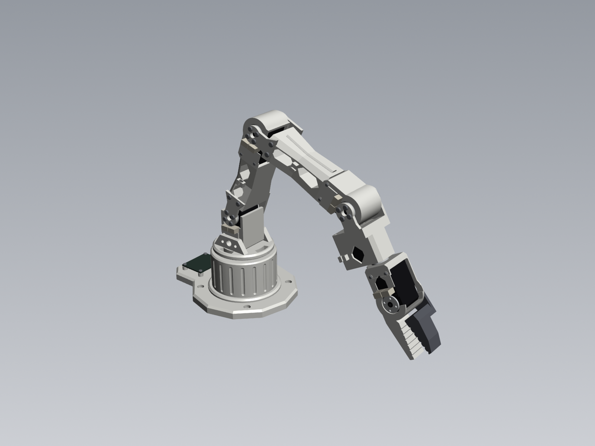

# Talos arm CAD

Parametric CadQuery model of the Talos 5-axis arm plus gripper, exported as a full STEP assembly.



## Files

| File | What it is |
| --- | --- |
| `talos_arm_assembly.step` | Full assembly in the "ready" display pose |
| `talos_arm_zero.step` | Same assembly with every joint at 0 (arm straight up) |
| `talos_arm.py` | Generator. All dimensions and poses live at the top |
| `render.py` | Renders PNG views into `renders/` and checks every part pair for interference |
| `drawings/TAL-000_drawing-set_rev-A.pdf` | Full technical drawing set, 23 A3 sheets: every feature of every part dimensioned, enough to rebuild each part by hand |
| `drawings/work-sets/` | The same set split in two, one PDF per person: see [Work sets](#work-sets) |
| `drawings/sheets/`, `drawings/previews/` | One PDF per part (all its sheets), plus a PNG preview of every sheet |
| `drawings.py` | Generates the drawing set from `talos_arm.py`, so the drawings always match the model |
| `print/` | Print-ready 3MF of every printed part, already turned onto its print face: see [Printing](#printing) |
| `print_files.py` | Writes `print/` from `talos_arm.py`, after `part_checks.py` passes for each part |
| `part_checks.py` | Measures every part's print mesh against the design dimensions, and checks the servo and idler plate fits: see [Dimension checks](#dimension-checks) |
| `servo_reference.py` | Checks every servo pocket against the real Feetech STS3215 model: see [The servo](#the-servo) |
| `cable_check.py` | Measures each bus cable run, servo to servo, through every joint's travel, against the cable length |
| `entry_review.py` | Pushes the real servo along each part's way in and reports the room round it at every depth: see [Entry paths](#entry-paths) |
| `export_parts.py` | Writes `parts/`: one STEP per printed part in its own frame, the frame its drawing sheet uses |
| `joint_sweep.py` | Turns the shoulder, elbow and wrist flex through their travel and reports where each first touches |
| `reference/so101/` | SO-101's CAD from [TheRobotStudio/SO-ARM100](https://github.com/TheRobotStudio/SO-ARM100) (STEP parts, full assembly, servo meshes and fit gauges), and the STS3215 servo pulled out of SO-101's assembly: `step/STS3215_from_SO101.step` |

## Drawings

[`drawings/TAL-000_drawing-set_rev-A.pdf`](drawings/TAL-000_drawing-set_rev-A.pdf) is the full set, 23 A3 sheets. Each part is also saved on its own in [`drawings/sheets/`](drawings/sheets) as a PDF of all its sheets. Every sheet has a PNG in [`drawings/previews/`](drawings/previews); parts with two sheets have `_sh1` and `_sh2` previews.

**Numbering:**
- **TAL-0xx:** assembly and reference sheets.
- **TAL-1xx:** printed parts, numbered in build order from the base to the gripper.
- **File names:** `<part no>_<name>_rev-<rev>`, for example `TAL-103_upper-arm_rev-A.pdf`.
- **Sheets:** the title block gives the sheet's place in the full set ("11 of 23"), and the part name says which of the part's own sheets it is ("part sheet 2 of 2").
- **Revisions:** the title block carries the revision letter. Bump `REV` in `drawings.py` when a released drawing changes.

| Part no. | Part | Sheets | Contents |
| --- | --- | --- | --- |
| TAL-000 | General assembly | 1 | Zero-pose assembly, joint heights, printed and bought parts lists |
| TAL-001 | Servo pocket reference | 2 | 1: the STS3215 servo (bought part, reference). 2: **servo pocket P**, the envelope every servo part cuts |
| TAL-002 | Common features | 2 | 1: the clevis (modelled into the links, not printed on its own). 2: cable clip, case screw hole, hex window |
| TAL-101 | Base | 2 | 1: top view. 2: front view and section A-A |
| TAL-102 | Shoulder | 2 | Turntable + cradle. 2: sections A-A, B-B and the left view |
| TAL-103 | Upper arm | 2 | 1: front and top views, with the idler plate pocket. 2: loft profiles A, B, C, section D-D and the bottom view |
| TAL-104 | Forearm | 2 | As the upper arm |
| TAL-105 | Wrist | 2 | 2: section A-A and the left view |
| TAL-106 | Gripper body | 2 | With the fixed jaw. 2: the left view and section A-A |
| TAL-107 | Moving jaw | 1 | |
| TAL-108 | Hub cap | 1 | ×3, over the output-horn screws. Front view and section A-A |
| TAL-110 | Idler plate | 1 | ×2, one on each arm link. Front and top views |
| TAL-111 | Servo fit gauge | 1 | Print it first: six windows, 0.2 to 0.7 mm clearance, with a table of their sizes for calipers |
| TAL-112 | Pocket test coupon | 1 | The elbow servo end of TAL-103, printed on its own to test the servo in a real pocket |
| TAL-113 | Clevis test coupon | 1 | The elbow clevis of TAL-104, printed on its own to test the joint |

### Work sets

The parts are split into two sets so two people can model them at the same time. Each set has about the same amount of work, counted in modelling steps on the feature lists.

| Set | File | Parts | Steps |
| --- | --- | --- | --- |
| A | [`TAL-SET-A_base-to-upper-arm_rev-A.pdf`](drawings/work-sets/TAL-SET-A_base-to-upper-arm_rev-A.pdf) | TAL-101 base, TAL-102 shoulder, TAL-103 upper arm, TAL-108 hub cap, TAL-111 fit gauge, TAL-112 pocket test coupon | 48 |
| B | [`TAL-SET-B_forearm-to-gripper_rev-A.pdf`](drawings/work-sets/TAL-SET-B_forearm-to-gripper_rev-A.pdf) | TAL-104 forearm, TAL-105 wrist, TAL-106 gripper body, TAL-107 moving jaw, TAL-110 idler plate, TAL-113 clevis test coupon | 54 |

- **Shared sheets:** both sets start with TAL-000, TAL-001 and TAL-002. Each person models servo pocket P and the common features from those, so both sides of every joint use the same geometry.
- **Where the sets meet:** only at the elbow. The upper arm's end shell (set A) holds the elbow servo, and the forearm's clevis (set B) clamps its horns. Both are defined on TAL-001 and TAL-002, so check them against each other before printing. The idler plate (TAL-110, set B) also screws onto the upper arm (set A): its pocket and screw holes are on TAL-103.
- **Similar parts:** the upper arm and the forearm are built the same way, with the same feature list and different numbers, so the two of you can cross-check each other's work on them.
- **Tags:** every sheet's title block carries a tag saying which set it belongs to. Sheet numbers ("6 of 23") follow the full set in every file, so a sheet is identical wherever it appears.
- **Changing the split:** edit `WORK_SETS` in `drawings.py` and regenerate.

Every feature is dimensioned on a view; nothing has to be read out of the text. The sheets use:
- **views:** front, top and side views in third-angle projection, with hidden lines dashed, plus an isometric
- **section views** where depth matters: hatched cut faces, with the cutting-plane line (A-A, B-B ...) on the parent view, which may be on the part's other sheet
- **ordinate dimensions** measured from the part origin (the 0 datum), so every value is a coordinate you can type straight into a sketch
- **linear dimensions** for sizes, and **callouts** for holes, diameters, radii and chamfers: for example `4X ⌀3.2 THRU ⌴⌀6.5 ↧6`, where ⌴ is a counterbore and ↧ its depth
- **coordinate tables** in the right-hand column for polygon outlines (window, keel, finger, cheek and deck points), tagged on the view
- **P0**, a datum cross marking where each part's servo pocket P sits; the feature list gives which way the servo points
- a numbered **feature list**: the modelling order, with the same numbers

Lettering is ISOCPEUR, the ISO 3098 drawing font, with GENISO for the ⌴ and ↧ symbols. Both are embedded in the PDFs, so they look the same on any computer. To regenerate the drawings the fonts must be installed; they come with SolidWorks and AutoCAD. Without them `drawings.py` falls back to DejaVu Sans.

Coordinates are in the part's own frame, the frame `talos_arm.py` builds it in, and each sheet's title block says where that frame sits. For the arm links, the origin is on the proximal joint axis, X runs to the distal axis, and Y is the joint axis. Rebuild each part in that frame and the parts mate on the same axes as the STEP. The STEP itself is a good check: import it alongside your model and compare.

Regenerate after any change to the model:

```bash
python drawings.py
```

The STEP keeps the kinematic tree as nested sub-assemblies (`shoulder_link` → `upper_arm_link` → `forearm_link` → `wrist_link` → `gripper_link`), so each link can be suppressed or re-mated in SolidWorks. Parts carry colours:
- off-white for printed structure
- graphite grey for the hub caps and the moving jaw
- black for the servo bodies and aluminium for their horns
- cream for the bus plugs
- steel for the screws
- dark green-grey for the bus board

Each servo's horns sit in the next link's sub-assembly, because that's the part they're bolted to and turn with.

The STEP files are exported **Y-up**, the SolidWorks convention, so the arm stands upright in the isometric view, with the base on the Front-Top ground plane. The arm reaches along +X. Internally the model, calcs and renders use Z-up; `python talos_arm.py --z-up` exports in that frame instead.

## Layout

Servo placement follows the SO-ARM100 / SO-101 pattern: six Feetech STS3215 servos, each held in a printed shell. Each pitch servo carries two horns: the output horn on its shaft and the passive horn, which turns freely on the idler boss on its back face. The next link screws into both, 4× M3 on each side. Nothing is screwed into the idler boss itself: it doesn't turn, so a screw there would clamp the moving link to the servo case.

| Joint | Servo | Mounting |
| --- | --- | --- |
| 1 Base pan | vertical, in the base column | turntable bolts to the horn |
| 2 Shoulder | horizontal, hanging in the shoulder cradle | upper-arm clevis: output horn (+Y) and passive horn (−Y) |
| 3 Elbow | in the upper arm's end shell | forearm clevis, same pattern |
| 4 Wrist flex | in the forearm's end shell | wrist clevis, same pattern |
| 5 Wrist roll | in the wrist cradle, shaft along the arm | gripper bolts to the horn |
| 6 Jaw | in the gripper housing | moving jaw on the horn |

Each clevis plate turns 1.0 mm clear of the shell it straddles: the shell walls' outer faces are 18.4 mm from the servo's mid-plane and the plates start at 19.4. A Ø19 pad on each plate's inner face bridges the gap to the horn (0.7 mm on the output side, 0.85 on the passive side), and the horn screws go through pad and plate. The first design had 0.5 mm, and the printed elbow test pieces rubbed through the turn: elephant's foot on the shell's edge and end play in the passive horn took the rest.

Link lengths are roughly SO-101 size: 116 mm shoulder to elbow, 135 mm elbow to wrist, 63 mm wrist to roll flange and 108 mm roll flange to jaw tip. That gives about 420 mm of reach from the shoulder axis. The pan horn is 62 mm above the table and the shoulder axis is 108 mm above it.

## The servo

Talos uses the Feetech STS3215, the same servo as SO-101. The 12 V 30 kg·cm version (C018 or C047, sold in packs such as RCmall's 6-pack) and the 7.4 V version (C001) share one case, so every variant fits the same pockets.

The first printed Talos parts didn't take the servos. The servo model they were built from was a box with flat caps, measured from SO-101's simplified simulation mesh, and the real case is bigger in six places. Its horns and screw holes also differ:

| Feature (from the servo's mid-plane) | Old model | Real servo | Change |
| --- | --- | --- | --- |
| Top face (output side) | flat cap at 15.9 | 15.5, with a raised rib 14 wide up to 16.45 (four small pips on it reach 16.6) | +0.55 over the rib, +0.7 at the pips |
| Bottom face (connector side) | 15.9 | 16.5 | +0.6 |
| Bump beside the connectors | 1.8 deep, to 17.7, x −29.9 to −19.9 | to 18.25 in the middle and 18.4 at its rim, x −29.7 to −17.7 | +0.7 deeper at the rim, 2.2 longer |
| Passive horn face | 17.7 | 18.55 | +0.85 |
| Idler boss tip | 18.3 | 19.1 | +0.8 |
| Bare output spline (horn off) | 16.2 | 17.2 | +1.0 |
| Horns | Ø20, holes on a 13.86 circle | Ø19.2, holes on a 14 circle | |
| Case screw holes, bottom face | (−33, ±10.3) | (−32.75, ±10.25), Ø1.6 | 0.25 nearer the shaft |
| Case screw holes, top face | (−29, ±10.3) | (−29, ±10.25), Ø1.6 | |

On top of that the pockets had only 0.3 mm of clearance, too little for FDM, and the arm links had no channel for the rib on the way in.

The sizes now come from Feetech's own CAD of the servo, the model inside SO-101's assembly STEP. It is in [`reference/so101/step/STS3215_from_SO101.step`](reference/so101/step/STS3215_from_SO101.step), together with SO-101's printed parts. [`servo_reference.py`](servo_reference.py) measures it, compares each size with the constants in `talos_arm.py`, and then puts the real servo into every Talos part:

- **Sizes:** every case size, the four M2 mounting holes each part uses and the horns' M3 hole circle are measured on the Feetech model. A model size may be up to 0.3 mm bigger than the real one where that only adds room, never smaller. Hole positions and horn faces must match to 0.05 mm.
- **In its pocket:** no part touches the case. There is 0.25 to 0.3 mm of room on every side; each servo is located by its case screws, not by a press fit.
- **On its way in:** the case slides out along its entry path for 60 mm without touching, with both horns off. The base and wrist servos also go in with their horns on. `part_checks.py` repeats this with both bus plugs fitted.
- **Horns:** both horns clear the shell they turn in. Where the servo goes in with its horns off, each horn also passes out through its opening, so it can be refitted.
- **Horn screws:** an M3 × 6 puts 1.8 mm of thread in the output horn and 1.65 mm in the passive horn, and stops 2.9 and 1.9 mm short of the servo case behind them.

Each case also has a second pair of holes in its bottom face beside the shaft, at (−8.3, ±10.25). The base and the wrist use it, so the pan and wrist roll servos are held at both ends (see [Screws](#screws)). Check that your servos have these holes before printing those two parts.

**Printing tolerance.** FDM prints come out slightly small on the inside, so every pocket is the servo plus 0.3 mm all round (`FIT_C`). The rib, bump, spline and idler boss channels are 0.4 mm off them (`PASS_C`). Both were set from the TAL-111 fit gauge printed on the Ender 3 V3 KE: the bare servo slid through the 0.3 window with light friction and was snug in the 0.2 one. 0.2 was not used: a pocket is four times deeper than the gauge, the arm parts are bigger, and the servo has to come out again. The horn openings are R10.8, which leaves 1.2 mm round the Ø19.2 horns. M3 clearance holes are Ø3.4. The TAL-110 idler plate's pocket is 0.3 mm bigger all round than the plate, because both parts are printed.

**What the clearance costs.** With 0.3 mm of room, nothing but the case screws holds a servo still. The two faces the screws pull on are also 0.3 mm off their walls, so the screws close that gap by bending the wall, or bridge it. Tighten the top-face screws (output side) first, then the bottom-face ones, and check them again after the first hour of running. The first pockets had 0.4; the gauge showed this printer holds size well enough for 0.3.

## Wiring

The six servos are daisy-chained on one bus from the board in the base. Each STS3215 has two 3-pin connectors in its bottom face, opposite the shaft, just past mid-length; the plugs go in straight from below. Every servo pocket includes a plug bay: the full connector footprint plus 12 mm for the mated plugs and the cable bend. The plugs are modelled (white), and the interference and joint-range checks include them.

| Hop | Cable | Route |
| --- | --- | --- |
| Board → pan servo | 21 cm | The board sits on a deck behind the column, on four standoffs for M2.5 screws (37 × 28 mm pattern, same Waveshare bus servo adapter as SO-101). A 12 × 9.7 mm tunnel runs from the deck into the pan servo's plug bay under the servo. |
| Pan → shoulder | **35 cm** | Back out through the same tunnel, then a service loop up the back of the column to a clip on the shoulder cradle's back face, and on to the shoulder servo's plugs on the cradle's −Y side. The loop sets the pan range: keep it to about ±110° in software, like SO-101. |
| Shoulder → elbow | 21 cm | Across the shoulder joint on the −Y side, outside the slim idler plate, through the clip on the upper arm's waist, and into the plug window in the elbow shell. |
| Elbow → wrist flex | 21 cm | Same pattern along the forearm. |
| Wrist flex → wrist roll | 21 cm | Across the wrist joint on the −Y side, into the roll servo's plug bay behind the servo. It opens under the −Y lug so the cable can enter from the side. |
| Wrist roll → jaw | **30 cm** | Through the clip under the wrist cradle's side window, then a loop around the roll axis to the plug window in the gripper housing's −Y side. Keep roll to about ±150° in software. |

**Cable lengths.** The servos come with 21 cm cables, and four runs fit them with 3 to 12 cm to spare. The two runs that wind round a turning axis don't: as the arm pans, the pan → shoulder cable wraps part way round the column, and the roll → jaw cable winds round the roll axis. Over ±110° of pan the first needs up to 29 cm, and over ±150° of roll the second up to 21 cm between the plugs, so use a 35 cm and a 30 cm cable there (any 3-pin bus servo cable with the same plugs). `cable_check.py` measures every run through its joint's travel, with 15 % added for bends and sag.

**Why the idler plates are slim:** the plugs sit only 11 mm from each pitch joint's axis, on the passive-horn side. So the −Y plate of each clevis is an R10.5 hub (just over the Ø19.2 passive horn) with a neck pinched to 17 mm, which keeps it clear of the plugs through the whole joint range. The +Y plate on the output horn keeps the full R16 hub. On the upper arm and forearm the idler plate is a separate part, TAL-110, screwed into a pocket in the beam, so the links print without support (see [Printing](#printing)). The wrist roll servo also sits 3 mm further forward than in the first version, so its plugs clear the end of the forearm shell.

## Fit test (before printing the arm)

Three small prints test the fit on your printer with one real servo before you print the arm. Print them with exactly the settings you'll use for the arm, elephant's-foot compensation included.

| Order | Part | What it tells you |
| --- | --- | --- |
| 1 | TAL-111 servo fit gauge | How much clearance your printer needs, to 0.1 mm. Six windows in the servo's outline (horns off), with the case grown by 0.2 to 0.7 mm and labelled. The arm's pockets use 0.3. `servo_reference.py` checks that Feetech's servo passes every window in CAD, so a window that stops the printed gauge is the printer, not the design. |
| 2 | TAL-112 pocket test coupon | Whether the servo really goes into an arm pocket. It is the elbow end of the upper arm (TAL-103), cut off and printed the same way, so everything is real: the way in through the bed face, the rib and bump channels, the bridged roof, the four M2 case screws and both horn openings. |
| 2 | TAL-113 clevis test coupon, and one TAL-110 idler plate | Whether the joint goes together. It is the elbow clevis of the forearm (TAL-104). It screws onto the servo's horns with the real M3 screws and an idler plate, so you can turn the joint by hand. |

**You need:** one servo, calipers, 4× M2 × 6 (or × 5), 8× M3 × 6 and 2× M3 × 10. The bus board is optional; it lets you centre the servo.

**A. Measure the servo** with calipers, away from the rib and the bump:
- length 45.2, from the end of the case to the end of the round shaft end
- thickness 32.0, from the top face to the bottom face
- width 24.8

**B. Gauge (TAL-111).** Take both horns off. Hold the servo on its side, top face toward the tall narrow notch for the spline. Push it into each window from the top face of the gauge, starting at 0.7 and working down. For each window, write down one of:
- **falls** through on its own weight
- **slides** through with a light push
- **push**: goes through, but only with a firm push
- **stops**: won't go through

If it stops right at the bottom face, that's elephant's foot: write "stops at the last layer". Then measure the LENGTH and THICK of the 0.3 window with calipers. The TAL-111 drawing gives the design sizes: 45.8 × 32.6.

**C. Pocket coupon (TAL-112).** Fit the servo exactly as in [Fitting the servos](#fitting-the-servos) below, then write down:
1. Does it go in from below by hand, or only with a push?
2. Does it sit flat against the roof? Can all four M2 screws start by hand, without forcing the servo sideways?
3. Do the screws tighten and stop, or do they spin without biting, or stop before the head seats?
4. How much does the screwed-in servo rock along its shaft? Guess in mm.
5. Does each horn go back on through its opening?

**D. Clevis coupon (TAL-113).**
1. Screw it onto the output horn with 4× M3 × 6.
2. Put the TAL-110 idler plate in its pocket with 2× M3 × 10, and screw it to the passive horn with 4× M3 × 6.
3. Write down: do all the holes line up, do all the screws tighten and stop, and does the joint turn by hand to ±100° without rubbing? ±100° is about a quarter turn plus 10° each way from straight.

**What the results mean:**

| Result | What it means | Next step |
| --- | --- | --- |
| 0.3 slides, 0.2 is snug or stops; C and D fine | The pockets suit your printer | Print the arm |
| 0.2 slides freely too, and the servo rocks in TAL-112 | Your printer holds size very well | Share the results; the pockets could come down to 0.25 |
| 0.3 pushes or stops, 0.4 to 0.7 slides | Your printer makes holes small | Turn up the slicer's X-Y hole compensation by the difference, or raise `FIT_C`, and reprint TAL-111 |
| LENGTH or THICK of the 0.3 window is more than 0.1 under size | Same: holes print small | As above |
| The servo measures more than 0.1 over 45.2 × 32.0 × 24.8 | Your servos differ from Feetech's CAD | Share the sizes; the pockets need to change |
| It passes the 0.3 window but not TAL-112 | Bridge sag at the roof, or elephant's foot at the bed face | Share where it stops |
| Screws won't start, or stop before the head seats | Hole position or screw length | Share which screw. Don't force it |

## Fitting the servos

Like SO-101, each servo slots into its printed part and screws in from outside, and the horns go on afterwards, through the openings in the shell:

1. **Check the fit first** with the three test prints: see [Fit test](#fit-test-before-printing-the-arm).
2. **Centre each servo and mark its output horn before taking anything off.** Set the servo to its middle position (2048) from the bus board, then draw a pen line across the output horn and the case. The joint limits are measured from this position, and one spline tooth off shifts the whole range by more than the 5° sweep step. If you can't power the servo yet, draw the line anyway and line it up again on refitting. The passive horn turns freely, so it needs no mark.
3. **Take both horns off** the shoulder, elbow, wrist flex and jaw servos. Each horn is held by one centre screw. The output horn lifts off its spline; the passive horn lifts off the idler boss on the back. The base and wrist roll servos can go in with their horns on.
4. **Plug in a 3-pin cable** before placing each servo; the plug bays are easier to reach then.
5. **Push the servo in** along its entry path (table below) and fit its M2 case screws.
6. **Refit both horns** through the R10.8 openings in the shell walls: the output horn on its spline with its centre screw, the passive horn on its boss with its centre screw.
7. **Fit the next link:** 4× M3 × 6 into the output horn, then 4× M3 × 6 through the idler plate into the passive horn (and, on the arm links, the idler plate's 2× M3 × 10 into the beam). The arm links go onto the output horn from the +Y side and the idler plate closes the −Y side. The wrist's clevis is one piece: spring its plates over the two horns.
8. **Hub caps last:** glue or tape them over the output-side screw heads.

### Build order

Some screws are covered by the next servo, so the order matters:

1. **Base:** pan servo into the column, 4× M2 case screws from under the base.
2. **Shoulder onto the pan horn** with 4× M3 × 6 from inside the empty cradle, straight down from above. Do this before the shoulder servo goes in: it sits over those screws.
3. **Shoulder servo** into the cradle, case screws through the cheeks, horns back on.
4. **Upper arm, elbow servo, forearm, wrist flex servo**, in that order, each as in the steps above.
5. **Wrist roll servo** into the wrist cradle and its 4× M2 case screws through the back wall, from the clevis side (two at the far end of the servo, two beside the shaft). Then the wrist onto the forearm.
6. **Gripper body onto the roll horn** with 4× M3 × 6 from inside the empty housing. A straight driver doesn't reach: use the short leg of a 2 mm hex key, with its long leg up through the open top. The lower two screws lie in grooves in the housing floor. Do this before the jaw servo goes in.
7. **Jaw servo** into the housing, case screws, output horn back on, then the moving jaw.

### Entry paths

Each servo goes into its printed part along a path that its case, top-face rib, bump, bare spline, idler boss and plugs can all travel. `servo_reference.py` slides the real servo out of each part along that path. `entry_review.py` measures the room round it at every depth on the way in: it never drops below the seated room (0.29 to 0.3 mm), so there is no tight spot partway in. The servo slides 22 to 30 mm with that room, about four times the gauge's thickness. A smooth push on the 0.3 window means a smooth, slightly longer push here.

| Part | Servo | Goes in |
| --- | --- | --- |
| TAL-101 base | pan | From above, connector end first. Horns can stay on. Feed the cable up through the tunnel first and plug it in before lowering the servo |
| TAL-102 shoulder | shoulder | From the top, far end first, horns off. The +Y cradle wall has a channel for the rib; the −Y wall a channel for the bump and a slot for the plugs and idler boss |
| TAL-103 upper arm | elbow | From below, shaft to +Y, horns off. The floor is open under the whole servo, with a 0.5 mm × 45° lead-in round the opening: the servo goes in through the face the part prints on, where elephant's foot would otherwise close the edge. The +Y wall has channels for the rib and the spline; the −Y wall a channel for the bump and a notch joining the plug window to the idler hole. The pocket roof prints as a bridge; TAL-112 tests that the servo still seats against it |
| TAL-104 forearm | wrist flex | From below, the same as the upper arm |
| TAL-105 wrist | wrist roll | Along its shaft axis, connector end first. Horns can stay on. The cradle floor prints as a 25 mm bridge along the whole way in, so it has 0.2 mm more room to sag into |
| TAL-106 gripper | jaw | From the top, horns off: the housing top is open over the whole servo, with the same channels as the arm links. The shaft-end wall prints as a 33 mm bridge along the whole way in, so it has 0.2 mm more room to sag into |

Until the case screws are in, nothing stops the servo sliding back out of its opening, so hold it in place while you fit them.

## Screws

All holes and counterbores are in the parts, and the screws are modelled in the assembly. Horn and passive-horn screws are M3 into the horns' tapped holes. Servo case screws are M2 self-tapping into the case's 1.6 mm holes. Every case screw seat takes either an M2 × 5 or an M2 × 6, so use whichever came with your servos: there is 2.4 mm of print under each head (2.5 on the arm links' and gripper's top faces), so an M2 × 5 goes 2.6 mm into the case and an M2 × 6 3.6 mm. SO-101 drives its M2 × 6 3.8 mm in, so the holes take either. Counts are for one arm:

| Where | Screw | Qty | Notes |
| --- | --- | --- | --- |
| Output horns: turntable, upper arm, forearm, wrist, gripper, moving jaw | M3 × 6 button head | 24 | 4 per horn on a 14 mm circle (9.9 mm square), plus a Ø7 centre hole for the horn's own centre screw. The turntable's go in from inside the cradle and the gripper's from inside the housing, both counterbored (see [Build order](#build-order)). 1.8 mm of thread in the horn |
| Passive horns: upper arm, forearm, wrist | M3 × 6 button head | 12 | 4 per horn through the idler plate, heads on its outer face. 1.65 mm of thread in the horn (2.2 mm thick at its holes); the tip stops 1.9 mm short of the servo case. The plate's Ø19 pad bears on the horn, and its Ø7 centre hole clears the idler boss |
| Idler plates to the arm links | M3 × 10 button head | 4 | 2 per plate, into Ø2.5 pilots 8 deep in the beam |
| Servo cases: elbow, wrist flex, jaw, top face | M2 × 6 or × 5 self-tapping | 6 | 2 per servo. They seat 1.0 mm over the rib's channel, so the heads stand 0.6 mm proud of the shell (out of reach of the next link) |
| Servo cases: elbow, wrist flex, jaw, bottom face | M2 × 6 or × 5 self-tapping | 6 | 2 per servo. The heads sit on Ø5.2 pads standing 0.5 mm off the shell, out of reach of the next link |
| Servo case: shoulder | M2 × 6 or × 5 self-tapping | 4 | Through counterbores in the cradle cheeks |
| Servo case: pan | M2 × 6 or × 5 self-tapping | 4 | From under the base, through Ø4.2 tunnels 24.4 deep: two at the far end of the servo and two beside the shaft. Use a driver with a shaft under 4 mm |
| Servo case: wrist roll | M2 × 6 or × 5 self-tapping | 4 | Through the cradle back wall and the bridge lug, from the clevis side: two at the far end of the servo and two beside the shaft, so it can't rock |
| Bus board | M2.5 × 6 self-tapping | 4 | Through the board's Ø2.5 holes into Ø2.1 pilots in the standoffs |
| Base to table | M4, user's choice | 4 | Counterbored holes in the plinth; the arm tips over unless these (or a clamp) are used |

That is 36 M3 × 6, 4 M3 × 10, 24 M2 × 6 (or × 5) and 4 M2.5 × 6. `case_screw_length()` in `talos_arm.py` checks every seat: an M2 × 5 must reach at least 2.4 mm into the case, and an M2 × 6 no more than 3.8.

The hub caps sit on the output-side clevis plates over the screw heads. Each has a 1.8 mm recess, which clears the M3 button heads (1.65 mm). The recess is 0.55 mm bigger than the ring of heads all round, so the caps don't grip anything: fix them with a drop of glue or double-sided tape. The idler side has no cap: one wide enough for its four screws would hit the parent servo's plugs.

The design language is original rather than a copy of the SO-101 parts. It uses:
- a 12-sided plinth with a fluted column
- faceted octagonal beams that narrow at the waist, with a raised spine and twin tapering hex windows
- matching hex windows on the wrist and gripper that show the servo inside
- arc windows in the turntable
- separate graphite hub caps
- slim 20 mm serrated jaws, centred on the wrist roll axis

The geometry is lightweighted where mass costs the most torque, in the gripper, wrist and forearm. The moving arm is 522 g, 70 % of it servos. See [`../calcs/README.md`](../calcs/README.md) for the numbers.

## Printing

Talos follows SO-101's printing rules:
- **Print-ready files.** [`print/`](print) has one 3MF per printed part, already turned onto its print face and sitting on z = 0. 3MF carries millimetres, so nothing imports at the wrong scale.
- **Settings:** PLA or PLA+, 0.4 mm nozzle, 0.2 mm layers, 3 perimeters and 20 % infill (what the calcs assume). The upper arm's elbow housing is the arm's lowest bending margin: print that part's walls solid (6 perimeters) if you can.
- **Supports:** on, but ignore slopes steeper than 45° and block them in horizontal screw holes. Drill those holes to size afterwards (3.4 mm for M3, 2.4 mm for M2 clearance). Bridges print unsupported.
- **Elephant's foot:** turn on the slicer's elephant-foot compensation (0.1 to 0.2 mm). The upper arm and forearm take their servo through the bed face, and the idler plates drop into a 0.3 mm pocket, so a flared first layer eats the clearance exactly where the parts go together. The arm links' servo openings also have a 0.5 mm × 45° lead-in at the bed face for this.
- **Keep the orientation in the file.** The gripper body stands 108 mm tall with its 20 mm fingers across the bed's Y travel (the stiff way). Don't turn it about Z on a bed-slinger such as the Ender 3 V3 KE.
- **Fit test first:** TAL-111, then TAL-112 and TAL-113. See [Fit test](#fit-test-before-printing-the-arm).

Each part's orientation was chosen by measuring its overhang in all six orientations. Every part sits flat on a solid first layer, checked by slicing each part 0.2 mm above the bed. Each first layer is one connected piece and has no specks or slivers:

| Part | On the bed | First layer | Support |
| --- | --- | --- | --- |
| TAL-101 Base | Plinth down | 15258 mm² | No support |
| TAL-102 Shoulder | Turntable down | 3612 mm² | No support |
| TAL-103 Upper arm | Flat underside down | 2562 mm² | No support (servo-opening roof and window tops bridge) |
| TAL-104 Forearm | Flat underside down | 3197 mm² | No support (servo-opening roof and window tops bridge) |
| TAL-105 Wrist | Upside down, flat top face down | 1231 mm² | Support only under the idler plate's neck (5 mm up); the cradle floor and plug bay roof bridge |
| TAL-106 Gripper body | Standing on the roll-horn disc | 1027 mm² | No support (one 32 mm bridge at the front of the servo opening); use a brim, the part is 108 tall |
| TAL-107 Moving jaw | Horn plate down | 882 mm² | Support under the finger |
| TAL-108 Hub cap ×3 | Outer face down | 437 mm² | No support |
| TAL-110 Idler plate ×2 | Outer face down | 683 mm² | No support. The screw heads sit on the outer face, so the bed face is one solid layer with plain holes |
| TAL-111 Servo fit gauge | Flat | 5350 mm² | No support. Print it first, with the same settings as the arm |
| TAL-112 Pocket test coupon | Flat underside down, as TAL-103 | 332 mm² | No support (the servo-opening roof bridges) |
| TAL-113 Clevis test coupon | Flat underside down, as TAL-104 | 664 mm² | No support |

## Dimension checks

Each 3MF is written only after its part passes `part_checks.py`, which measures the print mesh itself. The mesh is already turned onto its print face, so the check covers the file the slicer gets, not just the model. Each probe casts rays at a feature the design calls for, written from the design constants and the STS3215 sizes:

- **Holes:** every horn screw, centre, case screw, counterbore, pilot and mounting hole, sized and located to ±0.03 mm. Every ray from the hole's axis must land on the design radius.
- **Tool access:** from every case screw head, the screw's axis and a ring of lines round it (the head and a 3.5 mm driver shaft) run clear out of the part. The same for the pan horn screws inside the shoulder cradle, and for each horn through its opening in the shell. The gripper's roll horn screws are checked for the short leg of a hex key along the axis and its long leg up through the open top.
- **Joint geometry:** the pivot spacing L (the servo's R10.8 horn opening centred L from the clevis axis), plate thicknesses and inner faces, and the horn pads on the horn faces.
- **Servo pockets:** every wall 0.3 mm off the servo's faces, the rib and bump channels 0.4 mm off them, and the way in clear for 80 mm. `servo_reference.py` also checks every pocket against the Feetech model itself (see [The servo](#the-servo)).
- **Envelope:** heights, widths, the flat underside, the finger tip and width, the fit gauge windows, and the idler plate pocket.
- **Mesh:** closed with no open or non-manifold edges, its volume equal to the solid's, and its lowest point on z = 0.
- **Bed:** the part fits the Ender 3 V3 KE's 220 × 220 × 240 mm build volume with 5 mm to spare on every side.
- **First layer:** no first-layer island smaller than 5 mm².
- **Fits, on the solids:** each bare servo sits in its pocket without touching and slides out along its way in, and so do its two bus plugs. Each TAL-110 idler plate drops into its pocket.
- **Joint travel** (`joint_sweep.py`): the shoulder and elbow turn ±100° and the wrist flex −100° to +95° before anything touches, servo plugs and screw heads included. At ±105° the idler plate reaches the servo plugs, or one link reaches the next. Set the software limits inside these. The wrist flex range is the same with the gripper rolled 90° or 180° or the jaw open, and the wrist roll turns a full ±180° without touching (its cable is the limit).

This check found and fixed three defects:

- **Shoulder (TAL-102):** a 0.5 mm slit between the cradle walls and the cheeks. The cheeks now start on the walls.
- **Output clevis plates (arm links, wrist, moving jaw):** they stood 0.2 mm off the horn face. They now have a Ø19 × 0.2 pad, like the idler side.
- **Wrist (TAL-105):** its idler plate had lost its pad to the clevis gap cut. Both pads now stay.

A wall-thickness scan of every mesh (rays cast inward from each face) also found unprintable thin spots, now fixed:

- **Thin walls** over the bump's channel in the upper arm, forearm, gripper and shoulder. The channel runs 0.6 mm past the shell wall, so a 1.4 mm doubler on the outside leaves 0.8 mm (two perimeters) over it. It is out of reach of the next link's idler plate (see `joint_sweep.py`).
- **0.2 mm webs** between each M3 counterbore and the centre hole, on the shoulder and gripper. The centre is opened to Ø8.6 over the counterbore depth.
- **Webs and a 0.3 mm rim** round the idler plates' counterbores, on the first layer. The idler plates now have no counterbores: the M3 × 6 heads sit on the outer face.
- **A 0.2 mm wall** between the base's two new case screw tunnels and the plug bay. The wall is cut away, so each tunnel opens into the bay.
- **A knife edge** where each servo's plug bay meets its R10.8 idler opening. A small relief box blunts it.
- **Thin edges** where two column flutes broke into the base's cable tunnel. Those two flutes now start above the tunnel.
- **A 0.7 mm strip** where the moving jaw's grip notches ran into its horn plate. The notches now stop at the plate.

What remains under 0.75 mm is either the snap-fit cable clip roofs (0.7 mm, flexible on purpose) or sharp outside corners.

## Regenerate

```bash
python talos_arm.py               # ready pose -> talos_arm_assembly.step
python talos_arm.py --pose zero   # -> talos_arm_zero.step
python render.py                  # renders + interference report
python part_checks.py            # dimension and fit report for every part (verbose)
python print_files.py            # checks each part, then writes print/ (nothing written for a part that fails)
python servo_reference.py        # the real STS3215 against the model and in every pocket (a few minutes)
python joint_sweep.py            # joint travel before anything touches
python entry_review.py           # the real servo pushed along each way in: room at every depth
python cable_check.py            # each bus cable run against the cable length (--cable 300 for others)
python drawings.py               # the drawing set
python export_parts.py           # one STEP per printed part, into parts/
```

Requires `cadquery` (2.8) and, for `render.py`, `vtk` and `numpy`, which install with CadQuery. Add poses to `POSES` in `talos_arm.py` to export other configurations.

## Known simplifications

- The servo is modelled from boxes and cylinders sized from Feetech's CAD (see [The servo](#the-servo)); every model size is equal to the real one or up to 0.25 mm bigger. The pockets are checked against the Feetech model itself. The plugs are modelled as 11 mm blocks below the case; check your cables' plugs fit the plug bays.
- The board is modelled as a bare 42 × 33 mm PCB with Ø2.5 holes on a 37 × 28 mm pattern. That matches Waveshare's spec for the Bus Servo Adapter (A) that SO-101 uses. Components aren't modelled, so check where the power and USB ports sit before relying on rear access.
- Cables aren't modelled as solids, only their bays, tunnel and clips. Service loops at the pan and roll joints need slack: about 120 mm at the pan and 80 mm at the roll.
- Parts are single solids, apart from the arm links' separate idler plates. The servo shells are 2.5 mm thick beside the top face (1.3 mm over the rib channel) and 1.5 mm beside the bottom face.
- The passive horn is Feetech's: Ø19.2, a 1.95 mm disc (2.2 mm at its holes) with the output horn's 4-hole pattern. An M3 × 6 bites 1.65 mm into it.
- The depth of the case's M2 holes isn't known: Feetech's CAD draws them schematically. The screw lengths follow SO-101's practice (see [Screws](#screws)). Check one screw in a bare servo before fitting the rest.
- The horn holes are drawn at 45° to the servo's long axis. The output horn can go on its spline at any of 25 positions, and the passive horn turns freely, so set the angle when you refit the horns.
