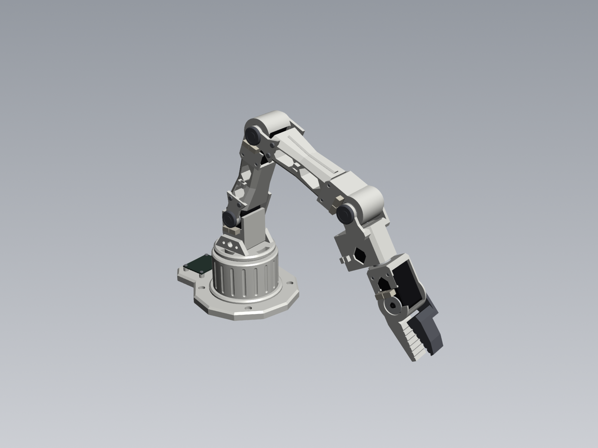

# Talos arm CAD

Parametric CadQuery model of the Talos 5-axis arm plus gripper, exported as a full STEP assembly.



## Files

| File | What it is |
| --- | --- |
| `talos_arm_assembly.step` | Full assembly in the "ready" display pose |
| `talos_arm_zero.step` | Same assembly with every joint at 0 (arm straight up) |
| `talos_arm.py` | Generator. All dimensions and poses live at the top |
| `render.py` | Renders PNG views into `renders/` and checks every part pair for interference |
| `drawings/TAL-000_drawing-set_rev-A.pdf` | Full technical drawing set, 21 A3 sheets: every feature of every part dimensioned, enough to rebuild each part by hand |
| `drawings/work-sets/` | The same set split in two, one PDF per person: see [Work sets](#work-sets) |
| `drawings/sheets/`, `drawings/previews/` | One PDF per part (all its sheets), plus a PNG preview of every sheet |
| `drawings.py` | Generates the drawing set from `talos_arm.py`, so the drawings always match the model |

## Drawings

[`drawings/TAL-000_drawing-set_rev-A.pdf`](drawings/TAL-000_drawing-set_rev-A.pdf) is the full set, 21 A3 sheets. Each part is also saved on its own in [`drawings/sheets/`](drawings/sheets) as a PDF of all its sheets. Every sheet has a PNG in [`drawings/previews/`](drawings/previews); parts with two sheets have `_sh1` and `_sh2` previews.

**Numbering:**
- **TAL-0xx:** assembly and reference sheets.
- **TAL-1xx:** printed parts, numbered in build order from the base to the gripper.
- **File names:** `<part no>_<name>_rev-<rev>`, for example `TAL-103_upper-arm_rev-A.pdf`.
- **Sheets:** the title block gives the sheet's place in the full set ("11 of 21"), and the part name says which of the part's own sheets it is ("part sheet 2 of 2").
- **Revisions:** the title block carries the revision letter. Bump `REV` in `drawings.py` when a released drawing changes.

| Part no. | Part | Sheets | Contents |
| --- | --- | --- | --- |
| TAL-000 | General assembly | 1 | Zero-pose assembly, joint heights, printed and bought parts lists |
| TAL-001 | Servo pocket reference | 2 | 1: the STS3215 servo (bought part, reference). 2: **servo pocket P**, the envelope every servo part cuts |
| TAL-002 | Common features | 2 | 1: the clevis (modelled into the links, not printed on its own). 2: cable clip, case screw hole, hex window |
| TAL-101 | Base | 2 | 1: top view. 2: front view and section A-A |
| TAL-102 | Shoulder | 2 | Turntable + cradle. 2: sections A-A, B-B and the left view |
| TAL-103 | Upper arm | 2 | 1: front and top views, with the idler plate pocket. 2: loft profiles A, B, C, section D-D and the bottom view |
| TAL-104 | Forearm | 2 | As the upper arm |
| TAL-105 | Wrist | 2 | 2: section A-A and the left view |
| TAL-106 | Gripper body | 2 | With the fixed jaw. 2: the left view and section A-A |
| TAL-107 | Moving jaw | 1 | |
| TAL-108 | Hub cap, large | 1 | ×3. Front view and section A-A |
| TAL-109 | Hub cap, small | 1 | ×3. Front view and section A-A |
| TAL-110 | Idler plate | 1 | ×2, one on each arm link. Front and top views |

### Work sets

The parts are split into two sets so two people can model them at the same time. Each set has about the same amount of work, counted in modelling steps on the feature lists.

| Set | File | Parts | Steps |
| --- | --- | --- | --- |
| A | [`TAL-SET-A_base-to-upper-arm_rev-A.pdf`](drawings/work-sets/TAL-SET-A_base-to-upper-arm_rev-A.pdf) | TAL-101 base, TAL-102 shoulder, TAL-103 upper arm, TAL-108 and TAL-109 hub caps | 42 |
| B | [`TAL-SET-B_forearm-to-gripper_rev-A.pdf`](drawings/work-sets/TAL-SET-B_forearm-to-gripper_rev-A.pdf) | TAL-104 forearm, TAL-105 wrist, TAL-106 gripper body, TAL-107 moving jaw, TAL-110 idler plate | 41 |

- **Shared sheets:** both sets start with TAL-000, TAL-001 and TAL-002. Each person models servo pocket P and the common features from those, so both sides of every joint use the same geometry.
- **Where the sets meet:** only at the elbow. The upper arm's end shell (set A) holds the elbow servo, and the forearm's clevis (set B) clamps its horns. Both are defined on TAL-001 and TAL-002, so check them against each other before printing. The idler plate (TAL-110, set B) also screws onto the upper arm (set A): its pocket and screw holes are on TAL-103.
- **Similar parts:** the upper arm and the forearm are built the same way, with the same feature list and different numbers, so the two of you can cross-check each other's work on them.
- **Tags:** every sheet's title block carries a tag saying which set it belongs to. Sheet numbers ("6 of 21") follow the full set in every file, so a sheet is identical wherever it appears.
- **Changing the split:** edit `WORK_SETS` in `drawings.py` and regenerate.

Every feature is dimensioned on a view; nothing has to be read out of the text. The sheets use:
- **views:** front, top and side views in third-angle projection, with hidden lines dashed, plus an isometric
- **section views** where depth matters: hatched cut faces, with the cutting-plane line (A-A, B-B ...) on the parent view, which may be on the part's other sheet
- **ordinate dimensions** measured from the part origin (the 0 datum), so every value is a coordinate you can type straight into a sketch
- **linear dimensions** for sizes, and **callouts** for holes, diameters, radii and chamfers: for example `4X ⌀3.2 THRU ⌴⌀6.5 ↧6`, where ⌴ is a counterbore and ↧ its depth
- **coordinate tables** in the right-hand column for polygon outlines (window, keel, finger, cheek and deck points), tagged on the view
- **P0**, a datum cross marking where each part's servo pocket P sits; the feature list gives which way the servo points
- a numbered **feature list**: the modelling order, with the same numbers

Lettering is ISOCPEUR, the ISO 3098 drawing font, with GENISO for the ⌴ and ↧ symbols. Both are embedded in the PDFs, so they look the same on any computer. To regenerate the drawings the fonts must be installed; they come with SolidWorks and AutoCAD. Without them `drawings.py` falls back to DejaVu Sans.

Coordinates are in the part's own frame, the frame `talos_arm.py` builds it in, and each sheet's title block says where that frame sits. For the arm links, the origin is on the proximal joint axis, X runs to the distal axis, and Y is the joint axis. Rebuild each part in that frame and the parts mate on the same axes as the STEP. The STEP itself is a good check: import it alongside your model and compare.

Regenerate after any change to the model:

```bash
python drawings.py
```

The STEP keeps the kinematic tree as nested sub-assemblies (`shoulder_link` → `upper_arm_link` → `forearm_link` → `wrist_link` → `gripper_link`), so each link can be suppressed or re-mated in SolidWorks. Parts carry colours:
- off-white for printed structure
- graphite grey for hub caps and the moving jaw
- black for the servo bodies and aluminium for their horns
- cream for the bus plugs
- steel for the screws
- dark green-grey for the bus board

Each servo's horns sit in the next link's sub-assembly, because that's the part they're bolted to and turn with.

The STEP files are exported **Y-up**, the SolidWorks convention, so the arm stands upright in the isometric view, with the base on the Front-Top ground plane. The arm reaches along +X. Internally the model, calcs and renders use Z-up; `python talos_arm.py --z-up` exports in that frame instead.

## Layout

Servo placement follows the SO-ARM100 / SO-101 pattern: six Feetech STS3215 servos, each held in a printed shell. The next link clamps the servo's output horn on one side and its idler on the other.

| Joint | Servo | Mounting |
| --- | --- | --- |
| 1 Base pan | vertical, in the base column | turntable bolts to the horn |
| 2 Shoulder | horizontal, hanging in the shoulder cradle | upper-arm clevis: output horn (+Y) and passive horn (−Y) |
| 3 Elbow | in the upper arm's end shell | forearm clevis, same pattern |
| 4 Wrist flex | in the forearm's end shell | wrist clevis, same pattern |
| 5 Wrist roll | in the wrist cradle, shaft along the arm | gripper bolts to the horn |
| 6 Jaw | in the gripper housing | moving jaw on the horn |

Link lengths are roughly SO-101 size: 116 mm shoulder to elbow, 135 mm elbow to wrist, 63 mm wrist to roll flange and 108 mm roll flange to jaw tip. That gives about 420 mm of reach from the shoulder axis. The pan horn is 62 mm above the table and the shoulder axis is 108 mm above it.

## Wiring

The six servos are daisy-chained on one bus from the board in the base. Each STS3215 has two 3-pin connectors on its back face, opposite the shaft, just past mid-length. Every servo pocket includes a plug bay: the full connector footprint plus 12 mm for the mated plugs and the cable bend. The plugs are modelled (white), and the interference and joint-range checks include them.

| Hop | Route |
| --- | --- |
| Board → pan servo | The board sits on a deck behind the column, on four M3 standoffs (37 × 28 mm pattern, same Waveshare bus servo adapter as SO-101). A 12 × 9.7 mm tunnel runs from the deck into the pan servo's plug bay under the servo. |
| Pan → shoulder | Back out through the same tunnel, then a service loop up the back of the column to a clip on the shoulder cradle's back face, and on to the shoulder servo's plugs on the cradle's −Y side. The loop sets the pan range: keep it to about ±110° in software, like SO-101. |
| Shoulder → elbow | Across the shoulder joint on the −Y side, outside the slim idler plate, through the clip on the upper arm's waist, and into the plug window in the elbow shell. |
| Elbow → wrist flex | Same pattern along the forearm. |
| Wrist flex → wrist roll | Across the wrist joint on the −Y side, into the roll servo's plug bay behind the servo. It opens under the −Y lug so the cable can enter from the side. |
| Wrist roll → jaw | Through the clip under the wrist cradle's side window, then a loop around the roll axis to the plug window in the gripper housing's −Y side. Keep roll to about ±150° in software. |

**Why the idler plates are slim:** the plugs sit only 11 mm from each pitch joint's axis, on the passive-horn side. So the −Y plate of each clevis is an R10.5 hub (just over the Ø20 passive horn) with a neck pinched to 17 mm, which keeps it clear of the plugs through the whole joint range. The +Y plate on the output horn keeps the full R16 hub. On the upper arm and forearm the idler plate is a separate part, TAL-110, screwed into a pocket in the beam, so the links print without support (see [Printing](#printing)). The wrist roll servo also sits 3 mm further forward than in the first version, so its plugs clear the end of the forearm shell.

## Fitting the servos

Each servo has to go into its printed part before its horns and plugs, along a path its body, back pad, connector headers and idler boss can all travel. A check that slides the bare servo out of each part along its six axis directions confirms one clear path for every servo, and that it is locked in every other direction until its case screws go in:

| Part | Servo | Goes in |
| --- | --- | --- |
| TAL-101 base | pan | From above, shaft first |
| TAL-102 shoulder | shoulder | From the top, bottom end first. The −Y cradle wall has a channel for the back pad and a slot for the plugs and idler boss |
| TAL-103 upper arm | elbow | From below, shaft to +Y. The floor is open under the whole servo, and the −Y wall has a channel for the back pad and a notch joining the plug window to the idler hole |
| TAL-104 forearm | wrist flex | From below, the same as the upper arm |
| TAL-105 wrist | wrist roll | Along its shaft axis |
| TAL-106 gripper | jaw | From the top: the housing top is open over the whole servo, with the same −Y channels as the arm links |

In every part the order is the same: push the servo in along its path and hold it there, fit its case screws, plug in the bus cables through the −Y window, then fit the horns when the next link goes on. Until the case screws are in, nothing stops the servo sliding back out of its opening.

## Screws

All holes and counterbores are in the parts, and the screws are modelled in the assembly. Horn and passive-horn screws are M3 into the horns' 2.5 mm tapped holes. Servo case screws are M2 self-tapping into the case's 1.5 mm holes. Counts are for one arm:

| Where | Screw | Qty | Notes |
| --- | --- | --- | --- |
| Output horns: turntable, upper arm, forearm, wrist, gripper, moving jaw | M3 × 6 button head | 24 | 4 per horn on the 9.8 mm square pattern, plus a Ø7 centre hole for the horn's own spline screw. The turntable's go in from inside the cradle and the gripper's from inside the housing, both counterbored. |
| Passive horns: upper arm, forearm, wrist | M3 × 8 button head | 3 | One centre screw into the idler boss |
| Idler plates to the arm links | M3 × 10 button head | 4 | 2 per plate, into Ø2.5 pilots 8 deep in the beam |
| Servo cases: elbow, wrist flex, jaw | M2 × 5 self-tapping | 12 | 2 per face, counterbored 1.1 mm into the shell walls |
| Servo case: shoulder | M2 × 6 self-tapping | 4 | Through counterbores in the cradle cheeks |
| Servo case: pan | M2 × 6 self-tapping | 2 | From under the base, through Ø4.2 tunnels |
| Servo case: wrist roll | M2 × 6 self-tapping | 2 | Through the cradle back wall; fit before the gripper |
| Bus board | M2.5 × 6 self-tapping | 4 | Through the board's Ø2.5 holes into Ø2.1 pilots in the standoffs |
| Base to table | M4, user's choice | 4 | Counterbored holes in the plinth; the arm tips over unless these (or a clamp) are used |

The hub caps press onto the clevis plates over the screw heads. Each has a 1.8 mm recess, which clears the M3 button heads (1.65 mm).

The design language is original rather than a copy of the SO-101 parts. It uses:
- a 12-sided plinth with a fluted column
- faceted octagonal beams that narrow at the waist, with a raised spine and twin tapering hex windows
- matching hex windows on the wrist and gripper that show the servo inside
- arc windows in the turntable
- separate graphite hub caps
- slim 20 mm serrated jaws, centred on the wrist roll axis

The geometry is lightweighted where mass costs the most torque, in the gripper, wrist and forearm. The moving arm is 526 g, 70 % of it servos. See [`../calcs/README.md`](../calcs/README.md) for the numbers.

## Printing

- **Upper arm and forearm (TAL-103, TAL-104):** print standing on the flat underside (z = −15 in the part frame), with no support. The clevis gap is open top to bottom once the idler plate is a separate part. What's left are bridges: the servo opening's roof (32 mm) and the window tops (6 to 9 mm). The hex windows' 45° flanks are self-supporting in this orientation.
- **Idler plates (TAL-110):** outer face down, no support.
- **Hub caps (TAL-108, TAL-109):** outer face down.
- **Other parts:** not yet checked for orientation; see the note under [Known simplifications](#known-simplifications).

## Regenerate

```bash
python talos_arm.py               # ready pose -> talos_arm_assembly.step
python talos_arm.py --pose zero   # -> talos_arm_zero.step
python render.py                  # renders + interference report
```

Requires `cadquery` (2.8) and, for `render.py`, `vtk` and `numpy`, which install with CadQuery. Add poses to `POSES` in `talos_arm.py` to export other configurations.

## Known simplifications

- The servo is a simplified STS3215, measured from the SO-ARM100 reference model: body, back pad, connector headers, case holes and horn holes. Check the connector positions and case-hole depths against a real servo before printing.
- The board is modelled as a bare 42 × 33 mm PCB with Ø2.5 holes on a 37 × 28 mm pattern. That matches Waveshare's spec for the Bus Servo Adapter (A) that SO-101 uses. Components aren't modelled, so check where the power and USB ports sit before relying on rear access.
- Cables aren't modelled as solids, only their bays, tunnel and clips. Service loops at the pan and roll joints need slack: about 120 mm at the pan and 80 mm at the roll.
- Parts are single solids, apart from the arm links' separate idler plates. Before printing, check wall thickness (the servo shells are 2.2 mm beside the caps). The base, shoulder, wrist and gripper haven't been checked for print orientation yet; split anything that won't print without support.
