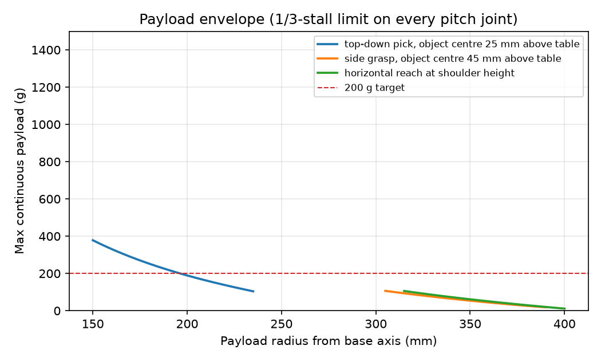

# Calculations

Checks of the arm against its servos and its printed PLA, in MATLAB. The masses, centres of mass and beam sections come from the CAD on the [`cad` branch](https://github.com/lucaschi2026-code/Talos/tree/cad/cad).

## Results

Arm held straight out (the worst case) with 200 g at mid-jaw, unless noted. The servo limit is 1/3 of stall (0.98 N·m) for continuous holding. The PLA limit is 10 MPa for sustained bending (creep).

| Check | Result | Status |
| --- | --- | --- |
| Shoulder holding | 1.73 N·m, 59 % of stall, 1.8× the limit | ❌ 200 g only with the elbow bent |
| Elbow holding | 1.06 N·m, 1.08× the limit | ⚠️ just over |
| Wrist flex / roll holding | 0.43 / 0.004 N·m | ✅ |
| 200 g top-down picks | Within the limit out to 195 mm from the base axis | ✅ the normal work zone |
| Shoulder, 90° in 1 s | 2.10 N·m peak, 71 % of stall | ✅ short peak |
| Pan servo shaft | 1.73 N·m overturning moment, carried by the servo's own bearing (SO-101: 1.87) | ✅ measure the play |
| Base tipping | Tips at full reach (1.12 N·m net) | ❌ clamp it with the rear M4s |
| Link bending | 5.8 MPa at the upper arm's elbow housing, SF 1.7. Forearm SF 2.7 | ⚠️ lowest beam margin |
| Tip sag from link bending | 2.3 mm | ✅ |
| Output clevis plates | SF 3.0 or more holding. At servo stall: SF 1.8 on the links, 1.1 on the wrist | ⚠️ wrist is the lowest SF on the arm |
| Horn screw bearing | 8.3 MPa at servo stall, SF 2.4 | ✅ |
| Idler plate screws | 0.5 MPa with the joint reaction doubled, SF 41 | ✅ |
| Shoulder servo cradle | 5.4 MPa at servo stall, SF 1.9 | ✅ |
| Pan servo case screws | 38 N worst on an M2, 7.4 MPa under the head (allowable 20) | ✅ |
| Grip | 23 N continuous at mid-jaw. 200 g needs 3.3 N at friction 0.3 | ✅ |
| Fixed finger root | SF 1.8 at jaw stall | ✅ |
| Joint ranges (CAD collision sweep) | Shoulder and elbow ±100°, wrist flex −100° to +95°, jaw 0–115° | ✅ |

Full numbers, methods and plots: [`design_check_results.md`](design_check_results.md).

## What we decided

1. **200 g with the elbow bent.** Top-down picks within 195 mm of the base axis. Light objects only at full reach.
2. **Clamp the base.** With the arm straight out, its centre of mass is 184 mm from the base axis with 200 g at mid-jaw (188 mm with it at the tip), and the base edge is 64 mm out. The two rear M4s need about 6 N each.
3. **No pan bearing for v1.** SO-101 runs the same servo with a higher shaft load. After assembly, load the arm straight out and measure the turntable rim: rim lift shows up 11.4× larger at the tip, so up to 0.1 mm is fine. Above that, fit a slide ring in the 2.8 mm gap under the turntable.
4. **Shoulder counterbalance for v2.** About 0.75 N·m of help at horizontal brings a straight-arm 200 g hold under the limit.

## Scripts

| File | What it does |
| --- | --- |
| [`design_check.m`](design_check.m) | The full check, eleven sections. Writes `design_check_results.md`, `shoulder_torque_cad.png` and `payload_envelope.png` |
| [`torque_check.m`](torque_check.m) | Hand calc for the shoulder and elbow, 200 g at the jaw tip: 1.77 and 1.09 N·m. Saves `shoulder_torque.png` |
| [`pan_base_check.m`](pan_base_check.m) | Hand calc for the pan shaft, base tipping and turntable play, against SO-101. Saves `pan_moment.png` |
| [`results.txt`](results.txt) | MATLAB output of the two hand calcs |
| [`cad_inputs.json`](cad_inputs.json) | What `design_check.m` reads from the CAD: each part's mass, centre of mass and inertia, the beam sections every 2 mm, the joint ranges, and the screw and mount dimensions |
| [`export_cad_inputs.py`](export_cad_inputs.py) | Writes `cad_inputs.json` from the CAD. Runs on the `cad` branch |
| [`design_check.py`](design_check.py) | The Python original of `design_check.m`, with the same results. It builds the CAD, so it only runs on the `cad` branch |
| [`so101_compare.py`](so101_compare.py) | The same statics on SO-101's URDF, for the comparison numbers |

The hand calcs put the payload at the jaw tip, 18 mm further out than mid-jaw, so they come out about 2 % higher than `design_check.m`.

## Run it

Open a script in MATLAB and press F5. Each one takes a few seconds.

After a CAD change, on the `cad` branch:

1. Run `python calcs/export_cad_inputs.py` with the CAD's Python environment. It takes 5 to 15 minutes, mostly the collision sweep.
2. Run `design_check.m`.
3. Copy the new lumped masses from `design_check_results.md` (section 1) into `torque_check.m` and `pan_base_check.m`.

To try other print settings, change `M_SERVO`, `T_SHELL` or `INFILL` in `design_check.py`, which `export_cad_inputs.py` uses, and export again. 15 % infill with 2 perimeters cuts the printed moving mass by about a quarter.

## Assumptions to measure

- **Mass:** PLA at 1.24 g/cm³, 1.2 mm walls, 20 % infill. Each servo 55 g, plus 6 g of screws and cable. Weigh the printed parts.
- **Servo:** STS3215 at 12 V: 2.94 N·m stall, 4096 counts per turn, about 45 rpm. Check the datasheet for your variant.
- **PLA:** E = 2.3 GPa, 10 MPa sustained bending, 20 MPa screw bearing.
- **Backlash:** unknown. Each 0.5° at the shoulder moves the tip 3.7 mm, so measure it before promising repeatability.
