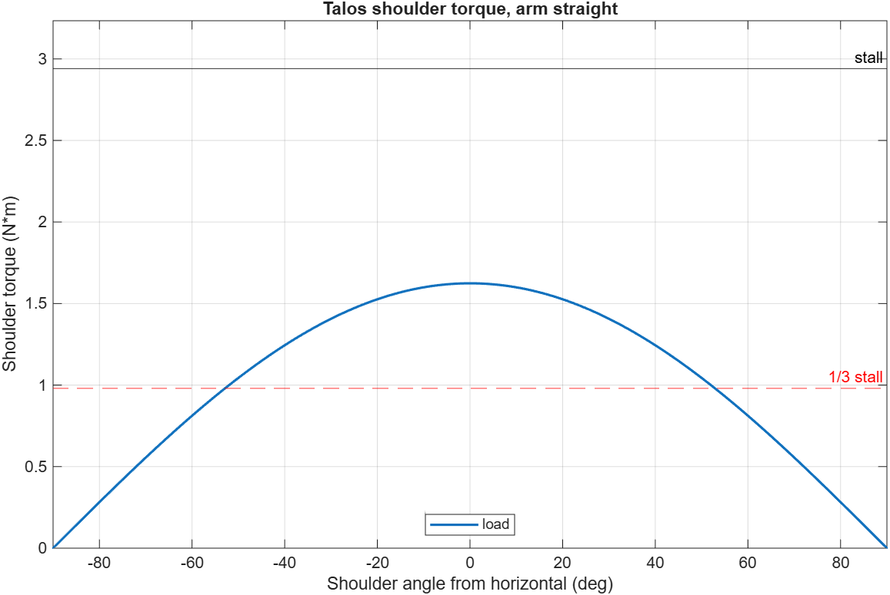

# Calculations

## Shoulder and elbow torque (`torque_check.m`)

**Question:** can STS3215 servos at the shoulder and elbow hold the arm and a 200 g payload, with the joint layout copied from SO-101?

**Method:** static moment balance with the arm held straight out (the worst case):

```
tau = g * sum(m_i * x_i)
```

where `x_i` is each mass's horizontal distance from the joint axis. Masses and centre-of-mass offsets come from the [SO-101 URDF](https://github.com/TheRobotStudio/SO-ARM100/blob/main/Simulation/SO101/so101_new_calib.urdf) (each link includes the servo mounted on it). Replace them with CAD or kitchen-scale values once parts exist.

**Limit:** keep continuous load under 1/3 of stall (2.94 N·m / 3 ≈ 0.98 N·m) so the servo doesn't overheat or droop.

### Inputs

| | Value |
| --- | --- |
| Upper arm (shoulder → elbow) | 120 mm |
| Forearm (elbow → wrist) | 120 mm |
| Wrist → gripper tip | 160 mm |
| Reach (shoulder → tip) | 400 mm |
| Payload | 200 g at the tip |
| Servo stall torque | 2.94 N·m (30 kg·cm, 12 V) |

### Results

| Joint | Torque | % of stall | vs 1/3 limit |
| --- | --- | --- | --- |
| Shoulder, 200 g payload | 1.62 N·m | 55 % | ❌ over |
| Shoulder, no payload | 0.84 N·m | 29 % | ✅ under |
| Elbow, 200 g payload | 0.96 N·m | 33 % | ✅ at the line |

The payload alone is about half the shoulder load (0.78 N·m) because it sits at the very end of the arm. Full output: [`results.txt`](results.txt).



Arm straight, the shoulder is only over the limit within about ±53° of horizontal. Angled further up or down, or with the elbow bent, it drops under.

### Decision

**No shoulder fix for v1.** SO-101 uses the same servos at about the same size with no counterbalance, and normal use (elbow bent, quick grabs) stays near or under the limit. Only a long hold of 200 g fully stretched out is a problem.

- Payload requirement becomes **200 g with the elbow bent**, or light objects at full reach.
- Once built, log shoulder load and temperature from the servo's own feedback. If it runs hot or droops, add a spring counterbalance in v2 and measure the before/after.

### Run it

Open `torque_check.m` in MATLAB and press F5. It prints the results, shows each mass's share of the shoulder torque, and saves `shoulder_torque.png`.
