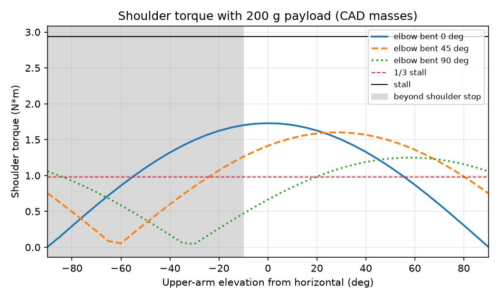
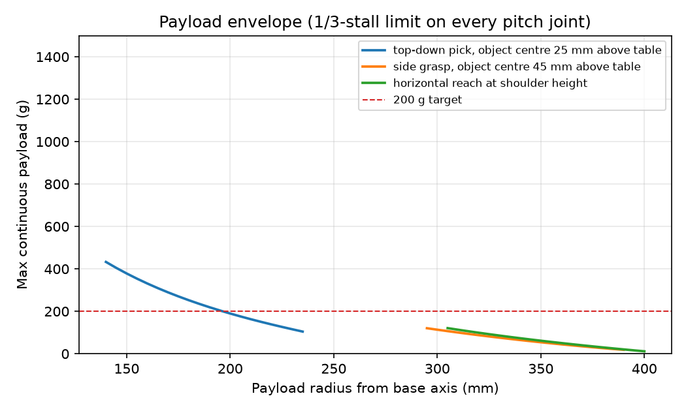

# Talos design check results

Generated by `design_check.py` from the CAD in `../cad/talos_arm.py`.

## Mass budget

Printed parts: PLA 1.24 g/cm3, 1.2 mm perimeters/skins, 20% infill. Servos: 55 g + 6 g screws and cable.

| Link | Printed (g) | Servo (g) | Total (g) |
| --- | --- | --- | --- |
| base (fixed) | 155 | 61 | 216 |
| shoulder_link | 39 | 61 | 100 |
| upper_arm_link | 52 | 61 | 113 |
| forearm_link | 57 | 61 | 118 |
| wrist_link | 31 | 61 | 92 |
| gripper_link | 40 | 61 | 101 |
| **total** | | | **738** |

Moving mass above the base: 523 g.

## 1. Static holding torque, arm straight out (worst case)

Limit: 0.98 N*m continuous (1/3 of 2.94 N*m stall). Payload 200 g at mid-jaw (151 mm past the wrist-flex axis).

| Joint | No payload (N*m) | With payload (N*m) | % stall | vs limit |
| --- | --- | --- | --- | --- |
| shoulder | 0.94 | 1.73 | 59 % | OVER (1.77x) |
| elbow | 0.50 | 1.06 | 36 % | OVER (1.08x) |
| wrist_flex | 0.13 | 0.43 | 15 % | OK (0.44x) |
| wrist_roll (worst roll angle) | | 0.004 | 0.1 % | OK |

Payload held at the very tip instead: shoulder 1.77 N*m.

The payload is 0.79 N*m of the shoulder load (46 %).

### Against the earlier `torque_check.m` model

| | torque_check.m (SO-101 values) | This CAD |
| --- | --- | --- |
| Upper arm L1 | 120 mm | 116 mm |
| Forearm L2 | 120 mm | 135 mm |
| Wrist flex -> tip | 160 mm | 169 mm |
| Moving links (4) | 385 g | 423 g |
| Shoulder, 200 g payload | 1.62 N*m | 1.73 N*m |
| Elbow, 200 g payload | 0.96 N*m | 1.06 N*m |

Lumped inputs to paste into `torque_check.m` (per-link mass incl. servo, CoM distance from the link's own joint, arm straight):

```
upper arm + elbow servo      m = 0.113 kg, CoM   81.2 mm from shoulder axis
forearm + wrist-flex servo   m = 0.118 kg, CoM   94.2 mm from elbow axis
wrist + wrist-roll servo     m = 0.092 kg, CoM   38.2 mm from wrist_flex axis
gripper + jaw servo          m = 0.101 kg, CoM  101.7 mm from wrist_flex axis
```



## 2. Joint ranges from CAD collision sweep

Swept in 5 deg steps until any solid overlaps by more than 1 mm3. Angles in the model convention (shoulder 0 = upper arm vertical, + = forward/down).

| Joint | Min (deg) | Max (deg) | Span (deg) |
| --- | --- | --- | --- |
| shoulder | -100 | 100 | 200 |
| elbow | -105 | 105 | 210 |
| wrist_flex | -105 | 95 | 200 |
| gripper | 0 | 115 | 115 |
| pan, wrist_roll | no mechanical stop | | servo 0-360 deg, cable-limited |

## 3. Payload envelope

Largest payload that keeps shoulder, elbow and wrist under the continuous limit, from IK over the reachable workspace.

| Task | Reachable radius (mm) | 200 g OK out to (mm) |
| --- | --- | --- |
| top-down pick, object centre 25 mm above table | 140 - 235 | 195 |
| side grasp, object centre 45 mm above table | 295 - 390 | never |
| horizontal reach at shoulder height | 305 - 400 | never |



## 4. Dynamic torque

Triangular velocity profile (accelerate half way, decelerate half way): alpha = 4*theta/t^2, omega_peak = 2*theta/t.

| Joint | Move | Inertia (kg*m^2) | alpha (rad/s^2) | omega peak (rpm) | Accel torque (N*m) | Static + accel (N*m) | % stall |
| --- | --- | --- | --- | --- | --- | --- | --- |
| pan | 180 deg in 1.5 s | 0.0590 | 5.6 | 40 | 0.329 | 0.33 | 11 % |
| shoulder | 90 deg in 1.0 s | 0.0589 | 6.3 | 30 | 0.370 | 2.10 | 71 % |
| elbow | 90 deg in 0.8 s | 0.0261 | 9.8 | 38 | 0.256 | 1.32 | 45 % |

Peak speeds are well under the servo's no-load speed (about 0.22 s/60 deg, 45 rpm at 12 V; check the datasheet for your variant). Short peaks above the 1/3 line are fine; the limit is for sustained holding.

## 5. Base: pan servo overturning moment and tipping

With the arm straight out, the pan servo's output shaft carries an overturning moment of **1.73 N*m** plus 7.1 N of axial load. On the SO-101 layout this goes through the servo's own output bearing, and the turntable rides 2.8 mm clear of the column.

Whole-arm centre of mass is 186 mm from the base axis; the base edge is 64 mm out. 
**The arm tips over unless the base is fixed down** (net overturning 1.12 N*m). Clamping through the two rear M4 holes needs 5.5 N per bolt before dynamic loads; an M4 bolt in a printed counterbore is good for well over 100 N.

## 6. Link bending stress and deflection

Arm straight out with 200 g. Sections are cut from the CAD every 2 mm; the core inside the 1.2 mm perimeters is counted at 20% stiffness. E = 2.3 GPa, allowable 10 MPa sustained.

| Link | Worst station (mm from joint) | Moment (N*m) | I_eff (mm^4) | Stress (MPa) | Safety factor | Tip deflection (mm) |
| --- | --- | --- | --- | --- | --- | --- |
| upper_arm_link | 112 | 1.08 | 4959 | 6.2 | 1.6 | 1.66 |
| forearm_link | 132 | 0.44 | 4772 | 2.7 | 3.8 | 0.66 |

Tip sag from bending of the two printed links: about 2.3 mm.

## 7. Horn screw bearing

All joint torque goes through the output horn's 4 screws (the idler side only supports). Bearing stress on the printed clevis plate:

| Joint | Peak torque (N*m) | Force per screw (N) | Bearing stress (MPa) | Safety factor |
| --- | --- | --- | --- | --- |
| shoulder (servo stall) | 2.94 | 106 | 8.8 | 2.3 |
| shoulder (holding, 200 g) | 1.73 | 62 | 5.2 | 3.8 |

Plate thickness 4.0 mm, M3 screws on a 14 mm circle, allowable 20 MPa.

The idler plates on the upper arm and forearm are a separate part (TAL-110), held by 2 M3 screws into the beam. They only support the passive horn, so worst case they carry the whole joint reaction (everything beyond the joint plus the payload), doubled for dynamics:

| Idler plate | Joint reaction x2 (N) | Force per screw (N) | Bearing stress (MPa) | Safety factor |
| --- | --- | --- | --- | --- |
| upper_arm_link (shoulder) | 12.2 | 6.1 | 0.51 | 39 |
| forearm_link (elbow) | 10.0 | 5.0 | 0.42 | 48 |

## 8. Gripper

- Grip force, continuous (1/3 stall): 23 N at mid-jaw, 15 N at the tip.
- Grip force, stall: 68 N at mid-jaw, 46 N at the tip.
- With friction 0.3 on both jaws, the continuous grip holds 1.4 kg; the 200 g target needs only 3.3 N of squeeze, so run the jaw servo at a low torque limit to avoid crushing parts.
- Fixed finger root (20 mm wide, 60 mm out), continuous grip: 0.57 N*m, 1.8 MPa, safety factor 5.5.
- Fixed finger root (20 mm wide, 60 mm out), stall grip: 1.71 N*m, 5.5 MPa, safety factor 1.8.
- Jaw opens 115 deg before hitting the housing: about 67 mm between the jaw tips.

## 9. Resolution and stiffness at the tip

| Joint | Lever arm to tip (mm) | Tip motion per encoder count (mm) | per 0.5 deg backlash (mm) |
| --- | --- | --- | --- |
| shoulder | 420 | 0.64 | 3.7 |
| elbow | 304 | 0.47 | 2.7 |
| wrist_flex | 169 | 0.26 | 1.5 |

One count on every pitch joint moves the tip up to 1.4 mm. Repeatability will be set by gear backlash and the 2.3 mm link sag, not by encoder resolution.

## 10. Forearm length sensitivity

CAD rebuilt with a different elbow-to-wrist length; everything else unchanged. Arm straight out, 200 g payload.

| Forearm L2 (mm) | Reach, shoulder to tip (mm) | Shoulder (N*m) | Elbow (N*m) | Elbow vs limit |
| --- | --- | --- | --- | --- |
| 115 | 400 | 1.62 | 0.96 | 0.98x |
| 120 | 405 | 1.65 | 0.99 | 1.01x |
| 125 | 410 | 1.68 | 1.01 | 1.03x |
| 135 (design) | 420 | 1.73 | 1.06 | 1.08x |
