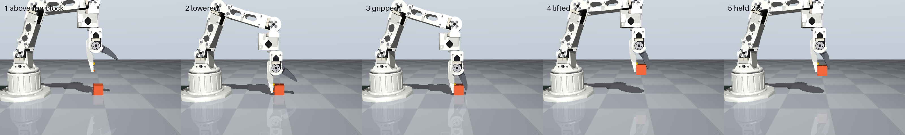

# Talos simulation

A MuJoCo model of the Talos arm, built from the CAD source on the [`cad` branch](https://github.com/lucaschi2026-code/Talos/tree/cad/cad). Use it to drive the arm from the keyboard, check what it can reach and lift, and find problems before printing.

The generated model is in `sim/model/`, so driving the arm and the auto pick test work on any branch. Rebuilding the model (`build_model.py`) and the full check (`check_model.py`) also need `cad/talos_arm.py`, the zero-pose STEP and `calcs/`, so run those on the `cad` branch.



## Run it

On Windows, double-click `sim\run.bat`, or run it from a terminal:

```bat
sim\run.bat                       :: drive the arm, with a 200 g block and a box to drop it in
sim\run.bat drive.py             :: just the arm
sim\run.bat test_autopick.py     :: auto pick and drop, no window
sim\run.bat check_model.py --fast
sim\run.bat build_model.py
```

The first run sets up Python 3.12 and the packages in `%USERPROFILE%\.venvs\talos-sim`, which needs [uv](https://docs.astral.sh/uv/) (`winget install astral-sh.uv`). Set `TALOS_SIM_VENV` to use another folder. It runs the base Python with the environment's packages, because Smart App Control can block the environment's own `python.exe`.

On macOS or Linux, set up once, with Python 3.12:

```bash
uv venv --python 3.12 ~/.venvs/talos-sim
uv pip install --python ~/.venvs/talos-sim -r sim/requirements.txt
```

Keep the environment outside OneDrive, because it holds thousands of files. Then, from the repo root, with that environment's Python:

```bash
python sim/drive.py              # drive the arm
python sim/drive.py --pick       # with a 200 g block and a box to drop it in
python sim/test_autopick.py      # auto pick and drop across the workspace, no window (about a minute)
python sim/check_model.py        # re-run every check and save the results and renders (several minutes)
python sim/check_model.py --fast # quicker version, prints only
python sim/build_model.py        # rebuild the model after a CAD change
```

## Driving

Hold a key to move a joint. Left drag orbits the view, right drag pans and scroll zooms. Change the keys in `KEYMAP` at the top of `drive.py`.

| Joint | + | − |
| --- | --- | --- |
| Pan | A | D |
| Shoulder (+ is forward and down) | W | S |
| Elbow (+ is down) | I | K |
| Wrist flex | U | J |
| Wrist roll | Q | E |
| Gripper (+ opens) | O | L |
| Back to the ready pose | R | |
| Quit | Esc | |
| Auto pick (with `--pick`) | G | |
| Auto pick and drop in the box (with `--pick`) | P | |
| Move the block, the box, or neither (with `--pick`) | B | |

With `--pick`, the block sits to the arm's left, square to the gripper at 90° of pan. Hold A for about 2 s to face it.

To pick it up, open the jaw (O), line the fixed finger up just inside the block, and lower until the tip is about 5–10 mm above the table (`z` in the readout). Hold L until the jaw is squeezing, and it keeps squeezing after you let go. Press O to release. Don't press down into the table first: the jaw then grips at a steeper angle, and the block can squeeze out when you lift.

### Auto pick, dropping in the box, and moving things

With `--pick`, press **G** or click **Grab block and pick up** and the arm picks the block up by itself. It doesn't set joint angles directly: it holds the same driving keys you would, through the same code, so it moves at jog speed under the same servo limits. While it runs:

- **The key panel** (bottom right) lights up each key as it's held.
- **The step list** (top right) shows each step, the keys held in it and for how long, and the angles the current step is aiming for. "tap" means a press under 50 ms.
- **The terminal** gets the whole sequence when it finishes, for copying out.

Press **P** or click **Pick up and drop in box** to also carry the block over the blue box and let go. After the lift it works out where the block actually sits in the jaw, then turns (A / D) and reaches (S / W and I / K, one joint at a time) so the block hangs over the box clear of its walls. If it would swing in low over a wall, it lifts a little more with K first. It never tilts the wrist while carrying. Then it opens (O) and backs away (K).

Press G or P again, or any driving key, to stop it and take over. It works out the pan and wrist roll from where the block is, so it handles a moved or turned block. From the default spot the sequence is: K to raise the arm and U to point the gripper down, O to open, A for 2 s to face the block, I and J to lower around it, L to grip, then K to lift.

Press **B** (or click the **Move** button) to switch between moving the block, moving the box, and neither. Slide it with the arrow keys (relative to your view) or drag it with the mouse, and turn it with Z / X. R puts the arm back, and the block and box where you last left them.

The auto pick reaches a block whose centre is about 165–220 mm from the base axis (160 mm if it's turned), up to about 100° of pan either way. The drop works with the box about 180–300 mm out, within about 105° of pan, and not right next to the block or in the way of the lift. Two tighter spots are refused too: a box at 180 mm across the base from a block close in, and a box across the base and nearer to it than the block, which needs a long swing and then a pull-in that tilts the block out of the jaw. Outside that, it says why it can't before it starts.

`test_autopick.py` checks all of this without a window: 42 block and box placements that must either drop the block in the box or be refused before the arm moves. Run it after changing the model, the jaw or `autopick.py`.

The box is a 70 mm square open tray with 35 mm walls. It's added in `drive.py`, not `build_model.py`, so it doesn't change the generated model or `check_model.py`'s tests.

The readout shows each joint's angle and its motor torque averaged over about 1 s:
- **`above 1/3 stall`:** more than the sustained-load rule of thumb used in [`../calcs`](../calcs). It's a warning about heat if held for a long time, and nothing stops the arm.
- **`AT STALL`:** the servo has no torque left, usually because the arm is pressing on the table or the block.

## Where the numbers come from

| Input | Source |
| --- | --- |
| Shapes | `cad/talos_arm_zero.step` (`cad` branch) |
| Joint positions | `cad/talos_arm.py` (`cad` branch), checked against the STEP on every build |
| Masses | The PLA model in `calcs/design_check.py`: 1.24 g/cm³, 1.2 mm perimeters, 20 % infill, 61 g per servo |
| Shoulder, elbow, wrist flex and gripper limits | CAD collision sweep in `calcs/design_check_results.md` |
| Pan and wrist roll limits | Cable limits in `cad/README.md` on the `cad` branch (±110°, ±150°) |
| Stall torque | 2.94 N·m, as in `calcs/` |
| Servo gains, damping, friction, rotor inertia | The SO-101 MuJoCo model, which uses the same servo. **Not measured on Talos** |
| Grip friction | 0.3, as in the design check |

Generated files live in `sim/model/`. Don't edit them by hand, because the next build replaces them. Edit `build_model.py` instead.

## Results

[`check_results.md`](check_results.md) has the full output. The model matches the CAD and calcs: the ready pose is within 0.001 mm of `talos_arm_assembly.step`, and the moving mass, holding torques and reach all match `design_check_results.md`.

What the simulation adds:

- **Speed costs torque.** With 200 g, lifting the shoulder 90° in 1.0 s stalls the servo for about 0.65 s and it falls about 9° behind. At 1.5 s it keeps up, at 94 % of stall. The design check's 72 % matches the same move going downhill, where gravity helps. This depends on the SO-101 damping value, so measure it on the real arm.
- **Block size is limited by the pivoting jaw.** Wider blocks sit in a steeper wedge and squeeze out. At friction 0.3 the jaw holds a 200 g cube up to 25 mm and drops it from 30 mm. At friction 0.5 it holds up to 40 mm. Grip pads or a rubber coating would help most. The model uses flat pads, so real serrations may do better.
- **How you lift matters as much as how you grip.** With the block held, lifting with the elbow alone (K) kept it at every spot tested, 155–220 mm out and turned up to 40°. Tilting the wrist up (U) while holding squeezes the block out of the pivoting jaw, even with U alone. S and K together also drop it, though each holds alone, and S alone drops it beyond about 200 mm. A straight-up lift needs U, so lift with K and accept a slight swing. So does stop-start motion: moving in 5 mm steps dropped the block even at a slow average speed, while one smooth hold didn't. Check this on the real gripper, because grip pads would change it.
- **Carrying works one joint at a time, turning before reaching.** Pan, shoulder and elbow each moved alone kept the block in the jaw on the way to the box in every placement `test_autopick.py` tries. Reaching before turning was worse: pulling the block in at the pick spot dragged it into the table, and swinging with the arm reached out let it creep further along the fingers. On a long swing the block creeps about 10 mm along the fingers, so a pull-in after a swing of more than 160° drops it once it tilts the gripper by about 5°. The auto pick refuses those. Arriving against the pan stop at ±110° also jolts it out, so the carry stays 3° inside every joint limit.
- **Single-joint limits don't cover every pose.** About 1 % of poses inside the limits touch the arm itself and 19 % hit the table, so control software should check a pose before moving to it.

## Simplifications

- **The base is fixed to the table,** as if clamped. `calcs/` shows it tips over otherwise.
- **Backlash, printed-part flex and servo heating aren't modelled.** Those need measuring on the real arm.
- **Sag is an estimate.** It comes from the servo gains, and the 2.1 mm of link bending in the design check isn't included.
- **Collision shapes are simplified.** Each link is a set of convex pieces, which err on the side of touching. The block only touches the flat grip pads on the gripper, so it can pass through the rest of the gripper housing.

## Smart App Control

`mujoco` is pinned to 3.8.0 because Windows Smart App Control, which is on for Ryan's PC, blocks a plugin DLL in the newest release. `build_model.py` doesn't need `cadquery`: it reads the STEP with OCP, the CAD kernel underneath it, because Smart App Control has at times blocked part of VTK, which `cadquery` imports. So it needs the STEP files to be up to date: after a CAD change, re-export them with `cad/talos_arm.py` first.
