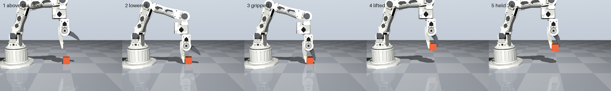

# Talos simulation

A MuJoCo model of the Talos arm, built from the CAD in [`../cad`](../cad). Use it to drive the arm from the keyboard, check what it can reach and lift, and find problems before printing.



## Run it

Set up once, with Python 3.12:

```bash
uv venv --python 3.12 C:\Users\<you>\.venvs\talos-sim
uv pip install --python C:\Users\<you>\.venvs\talos-sim\Scripts\python.exe -r sim/requirements.txt
```

Keep the environment outside OneDrive, because it holds thousands of files. Then, from the repo root, with that environment's Python:

```bash
python sim/drive.py              # drive the arm
python sim/drive.py --pick       # with a 200 g block to pick up
python sim/check_model.py        # re-run every check and save the results (several minutes)
python sim/check_model.py --fast # quicker version, prints only
python sim/build_model.py        # rebuild the model after a CAD change
```

## Driving

Hold a key to move a joint. Left drag orbits the view, right drag pans and scroll zooms. Change the keys in `KEYMAP` at the top of `drive.py`.

| Joint | + | − |
| --- | --- | --- |
| Pan | A | D |
| Shoulder (+ is forward and down) | W | S |
| Elbow (+ is down) | I | K |
| Wrist flex | U | J |
| Wrist roll | Q | E |
| Gripper (+ opens) | O | L |
| Back to the ready pose | R | |

The readout shows each joint's angle and its torque averaged over about 1 s. `OVER LIMIT` means that average is above 1/3 of stall, the continuous limit used in [`../calcs`](../calcs).

## Where the numbers come from

| Input | Source |
| --- | --- |
| Shapes | `cad/talos_arm_zero.step` |
| Joint positions | `cad/talos_arm.py`, checked against the STEP on every build |
| Masses | The PLA model in `calcs/design_check.py`: 1.24 g/cm³, 1.2 mm perimeters, 20 % infill, 61 g per servo |
| Shoulder, elbow, wrist flex and gripper limits | CAD collision sweep in `calcs/design_check_results.md` |
| Pan and wrist roll limits | Cable limits in `cad/README.md` (±110°, ±150°) |
| Stall torque | 2.94 N·m, as in `calcs/` |
| Servo gains, damping, friction, rotor inertia | The SO-101 MuJoCo model, which uses the same servo. **Not measured on Talos** |
| Grip friction | 0.3, as in the design check |

Generated files live in `sim/model/`. Don't edit them by hand, because the next build replaces them. Edit `build_model.py` instead.

## Results

[`check_results.md`](check_results.md) has the full output. The model matches the CAD and calcs: the ready pose is within 0.001 mm of `talos_arm_assembly.step`, and the moving mass, holding torques and reach all match `design_check_results.md`.

What the simulation adds:

- **Speed costs torque.** With 200 g, lifting the shoulder 90° in 1.0 s stalls the servo for about 0.65 s and it falls about 9° behind. At 1.5 s it keeps up, at 94 % of stall. The design check's 72 % matches the same move going downhill, where gravity helps. This depends on the SO-101 damping value, so measure it on the real arm.
- **Block size is limited by the pivoting jaw.** Wider blocks sit in a steeper wedge and squeeze out. At friction 0.3 the jaw holds a 200 g cube up to 25 mm and drops it from 30 mm. At friction 0.5 it holds up to 40 mm. Grip pads or a rubber coating would help most. The model uses flat pads, so real serrations may do better.
- **Single-joint limits don't cover every pose.** About 1 % of poses inside the limits touch the arm itself and 19 % hit the table, so control software should check a pose before moving to it.

## Simplifications

- **The base is fixed to the table,** as if clamped. `calcs/` shows it tips over otherwise.
- **Backlash, printed-part flex and servo heating aren't modelled.** Those need measuring on the real arm.
- **Sag is an estimate.** It comes from the servo gains, and the 2.1 mm of link bending in the design check isn't included.
- **Collision shapes are simplified.** Each link is a set of convex pieces, which err on the side of touching. The block only touches the flat grip pads on the gripper, so it can pass through the rest of the gripper housing.

## Smart App Control

`mujoco` is pinned to 3.8.0 because Windows Smart App Control, which is on for this PC, blocks a plugin DLL in the newest release. It also blocks part of VTK, which stops `cadquery` importing here, so `cad/talos_arm.py` and `calcs/design_check.py` won't run on this machine as they are. `build_model.py` avoids `cadquery` by reading the STEP with OCP, the CAD kernel underneath it. It needs the STEP files to be up to date, so re-export them on a machine that can run `talos_arm.py` after a CAD change.
