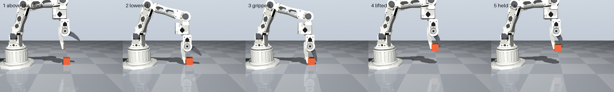

# Talos simulation check

Generated by `sim/check_model.py`. MuJoCo model built from `cad/talos_arm_zero.step`.

## A. Does the model match the CAD and the calcs?

| Check | Result | |
| --- | --- | --- |
| Ready pose vs `talos_arm_assembly.step` | worst bounding-box error 0.000 mm (upper_arm_link) | PASS |
| Moving mass | 529.2 g vs 529 g | PASS |
| Mass, upper_arm_link | 114.5 g vs 115 g | PASS |
| Mass, forearm_link | 119.2 g vs 119 g | PASS |
| Mass, gripper+jaw | 102.8 g vs 103 g | PASS |
| shoulder torque, no payload | 0.958 vs 0.96 N*m | PASS |
| elbow torque, no payload | 0.507 vs 0.51 N*m | PASS |
| wrist_flex torque, no payload | 0.137 vs 0.14 N*m | PASS |
| shoulder torque, 200 g | 1.746 vs 1.75 N*m | PASS |
| elbow torque, 200 g | 1.069 vs 1.07 N*m | PASS |
| wrist_flex torque, 200 g | 0.433 vs 0.43 N*m | PASS |
| Reach, shoulder axis to jaw tip | 420.0 mm vs about 420 mm | PASS |
| Build plan R2: reach from base axis | 420 mm, needs at least 350 mm | PASS |
| Joint limits | match the CAD sweep and cable limits | PASS |
| Joint directions | shoulder + moves forward and down; gripper + opens | PASS |

## B. What the physics adds

### Holding a pose with torque-limited servos

3 s from rest. Sag and tip drop come from the servo gains, so treat them as estimates until measured on the real arm.

| Pose | Payload | Shoulder (N*m) | % stall | Elbow (N*m) | Wrist (N*m) | Shoulder sag (deg) | Tip drop (mm) | vs 1/3 limit |
| --- | --- | --- | --- | --- | --- | --- | --- | --- |
| Ready | 0 g | 0.55 | 19 % | 0.40 | 0.06 | 0.03 | 0.2 | under |
| Ready | 200 g | 1.02 | 35 % | 0.79 | 0.21 | 0.06 | 0.4 | OVER: shoulder |
| Straight out | 0 g | 0.96 | 33 % | 0.51 | 0.14 | 0.05 | 0.6 | under |
| Straight out | 200 g | 1.75 | 59 % | 1.07 | 0.43 | 0.10 | 1.1 | OVER: shoulder, elbow |

### Shoulder speed: the servo's torque falls as it speeds up

Static calcs treat stall torque as always available, but a motor has none left at its no-load speed. The SO-101 joint damping (0.6 N*m per rad/s) has about the same slope as a straight line from stall to 45 rpm (2.94 N*m / 4.71 rad/s = 0.62), so at speed it eats into the torque the same way. That value comes from SO-101, not a test on this arm, so **treat these as a warning to measure, not a result**.

Shoulder moving 90 deg with 200 g on a triangular velocity profile. Section 4 of the design check uses the 1.0 s move:

| Move | Time (s) | Peak speed (rpm) | Peak servo torque (N*m) | Time at stall (s) | Worst lag (deg) | Error 1 s after (deg) |
| --- | --- | --- | --- | --- | --- | --- |
| Lift: out to up | 1.0 | 30 | 2.94 | 0.65 | 9.4 | 0.00 |
| Lift: out to up | 1.5 | 20 | 2.77 | 0.00 | 0.5 | 0.00 |
| Lift: out to up | 2.0 | 15 | 2.44 | 0.00 | 0.4 | 0.00 |
| Lift: out to up | 3.0 | 10 | 2.16 | 0.00 | 0.3 | 0.00 |
| Lift: out to up | 4.0 | 7 | 2.04 | 0.00 | 0.2 | 0.00 |
| Lower: up to out | 1.0 | 30 | 2.12 | 0.00 | 0.6 | 0.10 |
| Lower: up to out | 1.5 | 20 | 1.91 | 0.00 | 0.3 | 0.10 |
| Lower: up to out | 2.0 | 15 | 1.83 | 0.00 | 0.2 | 0.10 |
| Lower: up to out | 3.0 | 10 | 1.77 | 0.00 | 0.1 | 0.10 |
| Lower: up to out | 4.0 | 7 | 1.75 | 0.00 | 0.1 | 0.10 |

### Self-collision across the workspace

4000 random poses inside the joint limits, using simplified convex shapes that err on the side of touching: **1 %** have the arm touching itself and **19 %** hit the table. The single-joint limits don't protect every combination, so control software should check a pose before moving to it.

| Bodies in contact | Share of poses |
| --- | --- |
| base / gripper_link | 0.7 % |
| base / moving_jaw | 0.6 % |
| base / wrist_link | 0.3 % |
| base / forearm_link | 0.3 % |
| moving_jaw / shoulder_link | 0.1 % |
| gripper_link / shoulder_link | 0.1 % |

### Picking up a block

A 200 g cube on the table, 190 mm from the base axis: straight-down approach, close with the jaw torque limited to 1/3 stall, lift 55 mm, hold 2 s. Friction 0.3, as in the design check.

25 mm cube: **held**, raised 50.4 mm. Jaw at 25.8 deg, 0.98 N*m. Holding: shoulder 0.90, elbow 0.66, wrist 0.02 N*m (all under the 0.98 N*m limit). Peak in the lift: shoulder 1.13, elbow 0.94 N*m.

The moving jaw pivots instead of sliding, so a wider block sits in a steeper wedge. Same test at other widths and friction values. The pads are flat, so the real serrations could grip better than this:

| Block width (mm) | Jaw angle at grip (deg) | Friction 0.3 | Friction 0.5 | Friction 0.8 |
| --- | --- | --- | --- | --- |
| 15 | 12.3 | held | held | held |
| 20 | 18.7 | held | held | held |
| 25 | 25.8 | held | held | held |
| 30 | 33.9 | dropped | held | held |
| 35 | 42.3 | dropped | held | held |
| 40 | 50.6 | dropped | held | held |
| 50 | 64.6 | dropped | dropped | held |

## Summary

**All CAD and calc checks pass.**

